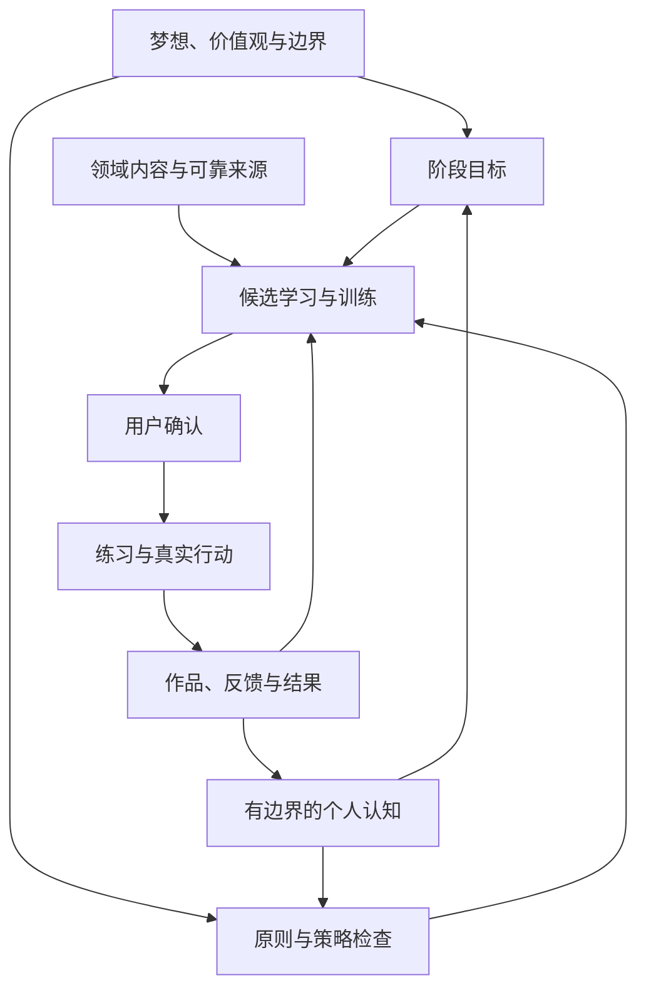

# Edward Personal Mastery System V4
**终身成长伙伴：完整产品架构与研发基线**

版本：V4.0-design / 2026-10-14  
性质：下一版本产品与技术架构规范，可交本地Codex、Qoder、Claude Code等执行源码盘点与任务拆解。  
对象：本人自用优先，后续小范围复制。  
语言：简体中文为默认交互，学习作品可使用中文、英文或双语。

## 0. 阅读与执行约定

### 0.1 文件地位

本文件合并V2、已确认V3.1、本轮终身成长伙伴方向，以及新增财商、领导力、投资与底层原则，成为下一轮的**产品研发基线**。本轮没有修改原软件、数据库或已发布体验站点；本文“必须”“应当”描述待实现要求。

已阅读基础材料：

1. 《Edward-个人成长成功系统-产品架构文档.md》v2.0，682行。
2. 《Edward_个人成长系统_V3_架构评审稿.md》，正文V3.1，725行。
3. 《Edward_产品生命周期评估与终身成长伙伴_MVP方案_20261014.md》。
4. 本轮明确新增的学习方向与个人底层法则。

现有文档自述FastAPI、Vue、PostgreSQL、Redis、飞书与既有功能；实际文件、依赖、数据库结构及实现完成度必须在仓库中核验。此前独立流程体验版v0.1支持部分交互，其23项测试不代表正式系统或本文件全部验收通过。

### 0.2 开发范围分层

- **P0基础：**原项目盘点、身份归属、数据保护、AI失败边界、迁移与回滚。
- **V4-MVP：**四入口、个人方向与原则、少量内容、通用训练、成长证据、确认式推荐、本地习惯与导出恢复。
- **P1增强：**更细的领域训练、持续检索、自适应任务、语音与更强复盘。
- **P2产品化：**外部用户自助引导、多用户验收、稳定运营与商业验证。

完整架构不要求一次实现全部长远功能。未实现能力必须明确显示状态。

### 0.3 证据与方法论分级

| 类型 | 使用方式 | 不应作出的推论 |
|---|---|---|
| 原研究或研究综述 | 支持学习、目标或团队机制 | 自动证明Edward有效 |
| 官方能力与课程框架 | 组织内容、学习目标与来源 | 等同认证、官方合作或授权课程 |
| 管理与思想实践框架 | 提供提问、行动与复盘模板 | 视为自然科学定律或标准心理量表 |
| 本项目组织模型 | 定义MASK、四力与价值审查 | 宣称有经验证的综合能力分 |
| 个人原则 | 用户明确确认后用于边界 | 根据职业、公司愿景或AI推测代填 |

选择依据是适用性、证据与可执行性，不声称某方法在所有情境中排名第一。文末S编号对应实际检索的一手资料。

### 0.4 尚未明确的个人定义

原稿明确MASK：Mindset、Attitude、Skills、Knowledge。

“价值法则”的具体个人定义、个人梦想清单、价值观排序和不可妥协边界，现有材料尚未明确。因此：

- 用户可填写、修改、确认，允许暂时为空。
- 候选“价值法则”：**价值观一致、真实价值创造、机会成本、长期可持续性**。确认前只作解释与提问，不作为已确认个人硬规则。
- “价值投资”是投资领域的一种研究视角，不能替代个人价值法则。
- 公司使命与职业可作背景，不能自动成为人生使命。

## 1. 产品定位与总体选择

### 1.1 产品定位

**围绕个人梦想、价值观与阶段目标，帮助本人理解、训练、应用与复盘，并沉淀可迁移成长资产的长期伙伴。**

产品表达：让每一次学习，都成为未来用得上的自己。

长期成果：

1. 更快理解重要概念，准确表达。
2. 将目标转成可完成的训练与行动。
3. 在财务、领导与投资情境中形成更有依据的判断。
4. 将学习、互动、行动与结果连接为个人成长体系。
5. 保留原稿、版本、来源、经验与认知，能够带走和恢复。

首个验证切入口保持：**交流现场理解陌生概念，之后用自己的话讲清并实际应用。**

### 1.2 已确认约束

| 约束 | 规范 |
|---|---|
| 第一批用户 | Edward或本人，私用账号 |
| 输入 | 手机术语或关键词 |
| 默认练习 | 每天10—15分钟，默认12分钟；忙时可主动选一个小任务 |
| 主要动力 | 看见作品与能力表现变化 |
| 主导航 | 问答、今天、知识、成长 |
| 领域 | AI、国学、英语、双语演讲、财商、领导力、投资；可新增 |
| 习惯 | localStorage，增改删、颜色、打卡、周月历、统计、导出恢复 |
| 推荐 | 理由、来源与产出清楚，确认后加入 |
| 资产 | 资料、作品、反馈、事件、认知分别记录 |
| 决策权 | 用户控制目标、价值观、行动与重要判断 |

### 1.3 架构策略

采用**共同成长引擎＋可配置领域内容＋版本化个人原则**。新增领域复用捕获、练习、证据与复盘。

不把所有心智模型做成仪表盘和强制测评。方法的价值体现在它改变了哪个选择、训练或复盘问题。

## 2. 总体架构与四入口

### 2.1 六层结构

| 层 | 责任 | 主要对象 |
|---|---|---|
| 个人方向与边界 | 梦想、价值、当前目标与不可违反的约束 | Dreams、Values、Roles、Boundaries、IntentVersion |
| 方法与策略 | 将原则转为可执行规则 | Framework、Policy、SkillSpec、RuleVersion |
| 领域与能力 | 可扩展知识与训练能力 | Domain、Competency、CurriculumNode |
| 日常互动与行动 | 问答、记录、练习、习惯、资料确认 | Query、Inbox、Practice、Task、Habit |
| 证据与认知资产 | 表现、应用与判断的来源和版本 | Artifact、Evaluation、Application、Principle |
| 可靠运行底座 | 身份、保存、任务、模型、迁移与恢复 | Auth、PostgreSQL、Queue、AIService、Export |



反馈只产生候选更新；修改个人价值观、边界与认知需要用户明确确认。

### 2.2 信息架构

| 入口 | 第一任务 | 二级能力 |
|---|---|---|
| 问答 | 当下理解并继续交流 | 短解释、现场表达、来源、收藏、随手记 |
| 今天 | 完成下一件有价值的事 | 回忆、表达、领域训练、任务、习惯、复盘 |
| 知识 | 让资料与想法有归处 | 收件箱、领域、来源、版本、能力卡、认知 |
| 成长 | 回看变化并选下一阶段 | 方向、目标、MASK证据、四力状态、作品、应用 |

领域通过筛选、内容集合与模板呈现，不新增财商、领导力、投资三个主导航。个人原则在成长页二级设置维护；今天只显示影响当前任务的短提示。

## 3. 个人成长宪章

### 3.1 最小个人方向模型

| 对象 | 内容 | 更新规则 |
|---|---|---|
| 梦想 | 希望实现的生活、贡献或身份方向 | 用户原话与整理稿并存 |
| 价值观 | 原则、含义、例子、优先级 | 用户确认，不从聊天自动升格 |
| 人生角色 | 自己、家庭、创业者、管理者等可选角色 | 可增减，不预设排序 |
| 阶段 | 当前处境、时间、重点、复查日 | 保存历史阶段 |
| 目标 | 近期成果与完成证据 | 最多3个活动目标 |
| 边界 | 不能接受的行为或代价 | 硬约束与软偏好区分 |
| 资源 | 时间、注意力、精力、可选预算 | 只存用户愿意提供的内容 |

首次使用可从一个阶段目标开始；完整梦想与价值观逐步填写。

### 3.2 生效优先级

1. 运行与数据安全：鉴权、归属、隐私、真实状态、禁止未授权外部执行。
2. 用户确认的个人硬边界。
3. 用户确认的价值观及冲突处理顺序。
4. 当前阶段目标、资源与明确指令。
5. 领域方法及用户确认的认知。
6. AI候选建议和偏好推测。

方法不能覆盖个人硬边界，AI不能自行改价值观。价值观彼此冲突且未定义顺序时，展示冲突与备选，由用户决定。

### 3.3 PolicyCheck输出

- verdict：allowed、needs_confirmation、needs_clarification、blocked。
- applied_policy_version、intent_version。
- matched_rule_ids、conflict_reasons、allowed_alternatives。
- checks_status：complete或insufficient_context。

未知价值观不等于已符合全部价值。普通概念问答可继续；敏感数据和重要行动补足相应条件。

确定性检查：身份、预算、时间上限、禁止动作、资料状态和可计算限制。语义检查：模型提出文字价值冲突的候选解释，不承诺完全识别，必要时由用户判断。

候选产生时检查，在接受和后台提交前再次核对版本，防止旧目标、旧边界下的任务迟到写回。

### 3.4 价值法则候选版本

value-review-v1，等待本人确认具体含义。

| 审查项 | 产品问题 | 保存结果 |
|---|---|---|
| 价值观一致 | 符合我重视的原则吗？ | 引用已确认价值；未知标未知 |
| 真实价值 | 改善谁的哪件具体事情？ | 受益对象、改善与证据 |
| 机会成本 | 会挤占哪件更重要的事？ | 替代行动与时间代价 |
| 长期可持续 | 能形成可复用能力吗，代价可承受吗？ | 资产、持续与停止条件 |

不合成人生价值分。先排硬冲突，再按目标相关、到期与时间约束排序，保留用户选择。

## 4. 底层方法怎样改变产品行为

### 4.1 方法映射

| 方法 | 身份与依据 | 进入哪里 | 产物与边界 |
|---|---|---|---|
| MASK | 原项目四维组织模型 | 缺口、训练、证据 | 具体证据，无全人格总分 |
| 第一性原理 | 思考工具 | 辨析、财务与投资案例、决策 | 事实、假设、约束、推导、验证 |
| 脑力心力体力毅力 | 项目自我管理视角 | 今日负荷、障碍、恢复 | 自报状态，无临床诊断 |
| SMART | 明确目标写作约定 | 目标与验收 | 结果、证据、资源、相关性、期限 |
| 七个习惯 | Covey实践框架[S07] | 自我管理、协作、更新 | 行为练习，不复制官方测评 |
| 价值法则 | 用户待确认规则 | 任务、机会、复盘 | 可解释的价值与代价 |
| 梦想与价值观 | 用户明确输入 | 目标、建议与边界 | 版本化意图，不代填 |
| 目标与障碍计划 | 目标研究、WOOP/MCII[S08][S09] | 从目标到行动 | if-then计划，允许退出 |
| 主动回忆与间隔练习 | 学习研究、调度[S10][S13] | 理解、表达、复习 | 首次作答、提示、间隔、反馈 |

每任务最多展示一个主方法与两个辅助方法；其余进入详情。用户不必懂整套术语才能完成任务。

### 4.2 MASK：缺口与训练

| 维度 | 本产品定义 | 证据 | 候选训练 |
|---|---|---|---|
| M Mindset | 看待问题、假设与不确定性的方式 | 区分事实和推测、发现反例 | 第一性原理、反证 |
| A Attitude | 当次任务行动意愿与互动方式 | 核实、倾听、修正的具体记录 | 对话、障碍反思、自主选择 |
| S Skills | 在特定任务完成动作的能力 | 表达、预算、话术、研究备忘录 | 演练、修订、应用 |
| K Knowledge | 概念、规则与边界知识 | 无提示回忆、来源解释 | 理解、制卡、检索 |

M与A可能重叠，不能假设四维是独立心理因子。缺证据显示待观察，不记0，不从签到和聊天语气推断人格。

MASK缺口引用任务或作品位置，先存suggested；用户确认后用于训练。旧mask_scores作为历史自评，不混入新证据。

### 4.3 第一性原理五格卡

first-principles-v1：

1. 真实问题：要理解或改善什么？
2. 已知事实：资料、观察或数据支持什么？
3. 关键假设：哪些是推测，怎样被推翻？
4. 约束与推导：资源、边界与可行解释是什么？
5. 小验证：下一步最小行动与修正条件是什么？

推理不能升级为事实，不能借此忽略已有可靠知识。普通问答不强制五格；复杂问题按需展开。

### 4.4 四力：状态、策略与恢复

| 视角 | 可记录 | 对任务的影响 | 不得推断 |
|---|---|---|---|
| 脑力 | 注意力与理解负担体验 | 缩短、拆成一个概念 | 智商、神经功能 |
| 心力 | 情绪负担、压力与价值冲突 | 温和提示、复盘、暂停 | 心理疾病或人格 |
| 体力 | 用户愿意提供的精力与休息体验 | 降负荷、保留任务 | 医疗诊断或运动处方 |
| 毅力 | 障碍、恢复、承诺是否合适 | if-then、小动作、复查目标 | 将中断归为意志缺陷 |

状态可跳过，默认unknown；低、一般、充足三档自报附可选描述，不构造总分，不改历史表现。

低状态提供按原计划、做小任务、今天暂停三个选择，选择后改变计划。医疗、心理治疗与体能处方不属本轮。

### 4.5 SMART：完成由证据确认

smart-growth-v1采用：Specific、Measurable、Achievable、Relevant、Time-bound。

写清情境；定义可观察作品、行为或结果；注明资源与障碍；关联个人方向；设置期限与复查日。允许质性证据，不强制所有目标量化为次数。

这是本产品采用的常见现代展开，不声称逐字复刻Doran原始定义。目标研究支持考虑反馈与任务条件[S08]，SMART作为写作与检查工具。

目标附不可接受代价、完成证据、障碍与if-then、复查及退出条件。里程碑数量达标只触发待确认完成；禁止100%自动完成，禁止收入或收益自动确认人生目标。

### 4.6 七个习惯：改变具体操作

名称沿用常见中文，训练为本产品原创；属于实践框架，不作为统一科学量表。[S07]

| 习惯 | 落点 | 本轮行为 |
|---|---|---|
| 积极主动 | 目标与复盘 | 可影响的问题转为下一步 |
| 以终为始 | 梦想与SMART | 写成果与证据 |
| 要事第一 | 今日任务 | 选重点，时间用完停止新增 |
| 双赢思维 | 领导与协作 | 双方需要及不能接受的代价 |
| 知彼解己 | 倾听与反馈 | 核对理解再表达 |
| 统合综效 | 决策与协作 | 比较不同意见，试共同方案 |
| 不断更新 | 复盘与四力 | 恢复与修订，调整不合适计划 |

双赢不要求接受不合理条件，倾听不等于放弃边界，毅力不排除停止错误目标。

### 4.7 方法的验收原则

方法只出现名称，却不影响任务、确认、反馈或复盘，视为尚未融入。每项必须至少有一条“输入 → 行为变化 → 证据 → 失败或冲突处理”用例。

## 5. 领域与能力地图

### 5.1 七个领域

| 领域 | 方向 | 作品 | 应用证据 |
|---|---|---|---|
| AI | 系统理解、业务表达、工程判断 | 解释、架构说明、实验 | 问题与结果 |
| 国学 | 文本、语境、实践反思 | 原文解读、边界、反思 | 行动与观察 |
| 英语 | 场景沟通 | 英文表达、对话 | 实际反馈 |
| 双语演讲 | 同一思想的双语表达 | 双语短讲、修订 | 场合与听众反馈 |
| 财商 | 日常财务与资源判断 | 现金流、费用比较、计划 | 依据与复盘 |
| 领导力 | 方向、协同、承诺与沟通 | 反馈、授权、协作复盘 | 互动与对方反馈 |
| 投资 | 风险、证据、估值与决策 | 教学案例、研究备忘录 | 事前判断与核对 |

财商与投资可共享概念，shared_concept_id去重，训练情境与能力要求分别定义。

### 5.2 扩展规则

领域是配置数据。Competency定义可观察能力：id、domain_id、title、observable_outcome、difficulty_stage、prerequisite_ids、allowed_template_ids、rubric_version、source_refs、framework_tags。

阶段为理解、独立表达、情境操作、真实应用，属于特定能力的证据状态，不表示整个领域身份等级。自述有经验可减少引导，表现比较仍留基线。自主预览前置内容，不用游戏解锁禁止读知识。

## 6. 财商成长体系

### 6.1 依据与边界

采用EU/OECD-INFE成人金融能力框架组织货币与交易、财务规划与管理、风险与收益、金融环境；它同时关注知识、技能行为及态度。[S01]

Edward的任务与量表是产品改编，不是官方认证。法律、税务和具体产品内容按适用地区与日期查证；条件缺失时只讲一般概念。

### 6.2 四条主线

| 主线 | 内容 | 原创训练 | 最小证据 |
|---|---|---|---|
| 看清资源 | 收支、余额、资产负债、现金流 | 区分存量与期间流量 | 有单位与时间的解释 |
| 规划取舍 | 预算、储蓄、债务、费用、长期目标 | 比较假设支出或融资方案 | 假设、成本、机会成本 |
| 风险韧性 | 流动性、保险、中断与欺诈识别 | 检查虚构案例 | 风险、未知、备选 |
| 环境责任 | 通胀、合同、利益冲突、数字安全 | 列核对问题 | 来源、地区、时间 |

### 6.3 首批六张概念卡

以下为种子规格，正式答案必须存来源与版本，不默认使用本人财务数据。

| ID | 概念 | 必要要点 | 常见误区 | 来源 |
|---|---|---|---|---|
| FIN-01 | 现金流与余额 | 期间流入流出与时点余额不同，注明单位 | 有资产就有可用现金 | S01 |
| FIN-02 | 净资产与负债 | 同时点资产减负债，区分估值和变现性 | 净资产等同收入 | S01 |
| FIN-03 | 复利与购买力 | 时间、收益率假设、费用与通胀 | 固定样例承诺未来收益 | S01、S02 |
| FIN-04 | 借款成本 | 利息、费用、期限、计费口径 | 只比宣传利率 | S01 |
| FIN-05 | 流动性与用途 | 何时需要钱、变现限制与不确定性 | 近期支出与长期资金混用 | S01、S03 |
| FIN-06 | 风险转移与利益冲突 | 保险范围与限制，合同与提供方动机 | 宣传替代条款 | S01 |

### 6.4 三个训练模板

1. 财务概念表达：解释一个概念，举虚构例子，注明限制。
2. 方案比较：两个假设方案的已知、未知、费用、时间与机会成本，允许无法判断。
3. 资源规划复盘：用户自愿提供一个决策过程，核对目标与结果；可匿名或用区间。

财商不以资产、收入或节俭程度评分，不鼓励为了等级改变消费或借贷。

## 7. 领导力成长体系

### 7.1 依据与评估

以CCL的DAC组织方向、协同与承诺，以SBI组织具体反馈，以Edmondson研究提醒团队学习与互动环境的重要性。[S04][S05][S06]

DAC观察协作，SBI构造话术。一次模拟对话不能证明领导力提升。对方体验与意图必须存来源，不能凭用户叙述代填。

### 7.2 四条主线

| 主线 | 问题 | 作品 | 观察 |
|---|---|---|---|
| 方向价值 | 团队理解要解决什么吗？ | 目标说明 | 对方如何复述 |
| 协同授权 | 责任、交接、边界清楚吗？ | 授权验收草稿 | 实际疑问 |
| 倾听反馈 | 观察、解释、影响分开吗？ | 反馈、倾听复述 | 对方回应与行动 |
| 学习复盘 | 分歧能形成改进吗？ | 协作复盘 | 改进实验 |

### 7.3 首批六张概念卡

| ID | 概念 | 必要要点 | 误区 | 来源性质 |
|---|---|---|---|---|
| LEAD-01 | 方向、协同、承诺 | 分别观察共同方向、配合方式、持续投入 | 只看个人魅力 | S04 |
| LEAD-02 | SBI反馈 | 情境、可观察行为、实际影响分开 | 把动机猜测写成行为 | S05 |
| LEAD-03 | 授权闭环 | 目标、责任、资源、边界、验收、复查 | 交代即代表理解一致 | 产品模板，参考S04 |
| LEAD-04 | 倾听与复述 | 先核对含义再表达观点 | 复述等于赞同 | S07实践改编 |
| LEAD-05 | 心理安全与学习 | 关注表达问题与学习的环境 | 低标准、无分歧或人格诊断 | S06 |
| LEAD-06 | 协作复盘 | 比较预期、实际、信息、下一步 | 只追责或只讲感受 | 产品原创模板 |

### 7.4 三个训练模板

1. 反馈对话演练：匿名情境写话术，模型扮演模拟对象；模拟反馈不能记为真实对方反馈。
2. 授权澄清：成果、资源与边界，设计一个检查理解的问题。
3. 真实互动复盘：实际说法、对方原话或本人观察，提出下次可验证改变。

评估事实具体、理解核对、行动清楚、边界尊重。不按下属服从程度或魅力打分。不自动给同事发消息。

## 8. 投资成长体系

### 8.1 依据与定位

以CFA Institute 2026 Investment Foundations公开课程组织基础学习，以SEC资料组织期限、风险与分散化；价值研究参考Berkshire原始股东资料。[S02][S03][S12]

本轮是投资学习与研究流程训练，不接交易账户、不下单、不代管资金。专业经验可改变任务难度，不放开未经授权外部执行。

### 8.2 四条主线

| 主线 | 范围 | 作品 | 标准 |
|---|---|---|---|
| 目标风险 | 用途、期限、承受能力、偏好、限制 | 教学版投资政策 | 条件清楚，保留未知 |
| 资产组合 | 工具、相关性、集中度、费用、流动性 | 虚构组合风险说明 | 多个风险来源 |
| 研究估值 | 事实、价值价格、假设、情景、反证 | 研究备忘录 | 主张与资料对应 |
| 决策复盘 | 事前判断、偏差、过程、结果 | 决策日记 | 保存事前版本 |

价值投资为可选视角，可扩展宏观、量化、趋势等路径。共用证据与风险纪律，不宣称单一风格适合所有市场。

### 8.3 首批六张概念卡

| ID | 概念 | 必要要点 | 误区 | 来源 |
|---|---|---|---|---|
| INV-01 | 目标与期限 | 用途、期限、资金可用性是讨论前提 | 只问最高收益 | S03 |
| INV-02 | 承受与损失 | 意愿、能力、场景分别讨论 | 口头不怕跌等于能承受 | S03，字段区分为产品设计 |
| INV-03 | 分散与相关性 | 多个暴露与相互关系，不消除全部损失 | 标的多就一定分散 | S02、S03 |
| INV-04 | 价值、价格、假设 | 估值依赖假设，价格是交易条件 | 估值视为确定真值 | S02、S12 |
| INV-05 | 假设与反证 | 主张、支持、替代解释、失效、复查 | 只收集赞成资料 | 原创研究模板，参考S02 |
| INV-06 | 过程与结果 | 留事前理由，分别复盘判断与结果 | 盈利即证明理由正确 | 产品决策复盘规则 |

### 8.4 三个训练模板

1. 风险解释：虚构案例的期限、流动性、集中度与信息缺口。
2. 研究备忘录：教学假设、资料、情景与失效条件，不生成无依据目标价。
3. 事前判断复盘：锁定当时观点，后续核对，禁止回改原稿美化结果。

### 8.5 计算与事实边界

数值注明单位、币种、时间、口径、输入来源与假设。模型解释，确定性工具计算并保存输入快照。

最小教学工具：

- 无新增现金流复利：FV=P×(1+r)^n，r期间与n一致。
- 实际收益率：(1+名义收益率)/(1+通胀率)−1。
- 损失恢复：0≤d<1时，恢复所需上涨=d/(1−d)。

使用用户给定或明确虚构值。固定r不是预测回报。不在P0做个人资产优化、仓位或税务计算。

行情、费用、产品规则和税务按地区与时间核对；不可用显示未知或仅讲一般概念。旧资料不伪装当前信息。

### 8.6 奖励边界

奖励假设完整、反证、风险说明与诚实修正，不奖励交易次数、杠杆、规模或短期盈利。“暂时无法判断”可以是合格回答。

案例training_mode为synthetic、historical、user_reflection。作品不会默认转为真实交易建议或已执行行为。

## 9. 通用学习闭环与问答契约

### 9.1 主流程

阶段目标 → 现场问题或随手记录 → 保存原稿 → 候选分类 → 用户确认 → 练习 → 实际应用 → 复盘 → 候选认知 → 用户确认。

记录不必全部进入练习；想法不必全部变成待办；阅读完成不代表能力达成。

### 9.2 现场问答

输入术语或关键词，场景可选。影响答案的歧义最多给三个选项；普通问题不要求先填写完整画像。

默认结果：

1. 一句话讲清，约30—60字。
2. 现场可以这样说，约50—100字。
3. 按需展开例子、易混点、边界与来源。

字数为软约束，事实和必要条件优先。依据状态为source_backed、generated、needs_verification。来源存在不等于主张得到支持，source_backed需有实际资料与主张映射。

缓存、已确认个人知识优先；时效资料核对日期。流式只包含正式答案；完成检查后开放收藏。未完成、空内容、推理片段、超时与错误提示不进入知识正文。

候选性能目标：缓存完整短答p95≤2秒；非缓存首段p95≤5秒；非缓存完整短答p95≤10秒；现场超时20秒。需按真实模型和手机网络测量，不是当前已达到的承诺。

后台查证产生新结果版本，不静默覆盖收藏版本。查询、尝试、结果版本分别标识；未知外部调用结果不能保证不重复计费。

### 9.3 收件箱与分类

类型：concept、idea、reflection、application、principle；领域可新增；目标关联可为空；状态pending、confirmed、archived。

先保存raw_body、来源与创建时间，再请求分类。模型仅建议类型、主要领域、可选目标、最多两个相关能力及理由；含义不明确保持pending。

用户可改分类、拒绝关联、保留原文。合并需预览并确认；原记录和来源仍可追溯。不删除既有领域与历史标签。

每条内容另存origin_kind：user_original、ai_generated、external_source、imported_legacy、mixed、unknown；保存可用author_ref、source_refs与generation_trace。确认分类只改变组织状态，不把AI内容的作者改为用户，也不代表已经掌握。

### 9.4 每日计划

默认12分钟：回忆4分钟、表达或领域情境5分钟、复盘3分钟。每天新增卡最多2张，候选新资料最多2条，后台并发默认1。

计划顺序：

1. 执行硬边界与用户资源限制。
2. 优先已有到期练习及已确认任务。
3. 根据活动目标、具体证据缺口选择一个主任务。
4. 在剩余预算内给少量新候选。
5. 用户确认后定稿，允许缩小或暂停。

不强制七个领域每天轮转。未选领域不推送；归档目标停止其主动推荐。四力未知按正常预算建议，不补造状态。

到期超过预算保留真实日期，不把未练任务算完成。习惯执行时间另计，记录动作轻量。完成学习不会自动替用户勾选习惯。

## 10. 训练、反馈与成长证据

### 10.1 统一任务契约

PracticeTask包含：task_id、user_id、domain_id、competency_id、goal_id、goal_version、intent_version、template_id、template_version、prompt、required_points、requires_example、requires_boundary、estimated_minutes、training_mode、source_refs、framework_tags、schedule_cycle_id。

任务生成后保存快照，不用后来变更的标准重评历史。无领域评分器时使用通用模板，显示可评估范围。

V4首批模板注册表，输入和输出继承上述共同契约：

| template_id | 情境附加输入 | 必须产出 | 评分重点 |
|---|---|---|---|
| finance-explain-v1 | 概念、给定虚构例子 | 自己的解释、一个边界 | 要点、单位、限制 |
| finance-compare-v1 | 两个方案、费用与期限，未知可空 | 条件比较、机会成本、无法判断处 | 口径与未知 |
| finance-review-v1 | 用户选定决策或虚构案例 | 目标、依据、结果与修正 | 条件和复盘诚实性 |
| leadership-feedback-v1 | 匿名事件、可观察行为 | SBI话术与模拟回应 | 事实与猜测、尊重 |
| leadership-delegate-v1 | 成果、资源、权限 | 授权草稿与理解核对问题 | 清晰、边界、复查 |
| leadership-review-v1 | 实际说法、反馈来源 | 协作观察与下次实验 | 信息来源与可执行性 |
| investment-risk-v1 | 虚构用途、期限、资产情境 | 风险说明与缺失条件 | 流动性、暴露、未知 |
| investment-thesis-v1 | 给定教学资料与假设 | 事实、情景、反证、失效条件 | 证据与风险纪律 |
| investment-review-v1 | 事前稿与后续资料 | 过程结果分离、观点修订 | 无事后改写、诚实更新 |

review类在真实资料缺失时只能用明确的虚构或历史案例；输出不进入真实应用统计。不同模板先采用文本输入，语音与复杂计算另行扩展。

### 10.2 原稿与反馈

首次原稿持久保存成功后才开放参考与点评；退出或模型失败也能在成长页找回。修订新建版本，以root_artifact_id连接。

assistance_mode为independent、hinted、reference_visible、ai_assisted、unknown。独立状态来源于用户声明及系统交互，不能声称识别外部辅助。

AI输出候选反馈、对应原文位置、遗漏、具体改进与证据不足。用户确认结果和AI候选分别保存。模型无法判断准确性时显示需核对。

### 10.3 通用量表

| 维度 | 0 | 1 | 2 |
|---|---|---|---|
| 概念准确 | 核心错误或未答出 | 部分正确，有遗漏 | 必要要点与边界合理 |
| 独立清楚 | 无法说清 | 有提示或零散 | 无提示且结构清楚 |
| 情境应用 | 用法不成立 | 用法合理，限制不完整 | 能说明用法与限制 |

没有相应任务要求记not_applicable，不记0。依据不足记unverified。有提示时独立表达最高1，用户评分不能覆盖提示事实。

领域附加项只按任务启用：

- 财商：时间单位、费用口径、条件与机会成本。
- 领导力：观察与猜测分离、理解核对、行动与边界。
- 投资：来源、风险情景、反证与事前判断。

不同领域、难度、任务与量表不直接平均。数据不足显示待观察，不合成成功指数或综合能力百分比。

### 10.4 三类主证据

1. 原始表达及修订：说明当次表现。
2. 延迟无提示回忆：说明某知识在明确间隔后的表现。
3. 真实应用：说明一次本人自述或附反馈的现实应用。

模拟、阅读、收藏、提示后重述分别标记。首次学习后的即时重述不计延迟回忆。成长页显示知识版本、日期、间隔、提示、评估者及样本数。

### 10.5 复习调度

沿用V3.1 sm2-core-budget-v1：q取0、3、4、5。首次作答前请求提示或揭示答案本周期q=0；提示后即时重述记补练。

只对新的、已到期有效周期：

- q<3：成功序列归0，间隔1天。
- 成功序列原值0：间隔1天。
- 原值1：间隔6天。
- 原值≥2：间隔=ceil(上期间隔×更新前EF)。
- EF=max(1.3,旧EF+0.1−(5−q)×(0.08+(5−q)×0.02))。
- 到期日=本次用户本地日期+间隔。

有效周期评分唯一；提前练习不推进序列。算法、总次数与连续成功序列分别存储。知识必要要点变化创建新版本与学习周期，历史作品引用旧版本。

延迟回忆除到期条件外，还须记录最近答案暴露时间，判断实际间隔；明确原始暴露信息缺失时记unknown，不伪造“延迟掌握”。

## 11. 推荐、检索与来源治理

### 11.1 推荐闭环

个人当前方向＋目标＋已有作品缺口＋时间预算 → 检索候选 → 资料核对 → 边界检查 → 推荐卡 → 用户接受、稍后或拒绝 → 学习任务 → 产出与反馈。

推荐必须说明：对应目标、具体缺口、为何现在适合、可靠依据、预计时间、完成后作品。资料不足允许不推荐，不能凑满数量。

每条保存：recommendation_id、goal_version、intent_version、source_refs、reason、expected_artifact、estimated_minutes、status、decision_at。

### 11.2 来源优先级

- 原始研究、官方监管与框架。
- 官方课程公开目录、原始公司披露、原著合法可用文本。
- 可靠机构解释性资料。
- 其他来源经核对后使用，标明性质。

不将营销文案作为研究证据。网页或PDF内容作为数据，不能改变系统权限、用户边界或执行指令。

Source字段：title、publisher、url、published_at（未知可空）、retrieved_at、source_kind、jurisdiction、language、supported_claims、location_ref、verification_status、content_hash。

网页选段、PDF页码或原文段落支持定位。机器核对与人工确认分别存，不把用户确认理解等同事实来源已验证。

### 11.3 时效规则

- timeless_concept：概念，不宣称“最新”。
- dated_reference：有明确年份或版本。
- current_fact：本次必须核对，返回as_of与适用地区。

缓存TTL按source_id与任务配置，不用一个TTL覆盖概念与行情。实时检索失败不借旧行情作当前判断。没有完整来源的材料可以成为待查证笔记，不能伪装已证实课程。

### 11.4 内容权利与数据最小化

保存必要引用、元数据、用户作品与允许的内容片段。官方课程全文、测评题库、量表与付费资料需要对应使用权；不能仅凭公开目录复制其课程。种子练习由本产品原创。

向模型发送当前任务必要内容，不默认发送全部价值观、财务原始数据、他人身份与个人反思。用户能看见当前AI处理范围。

### 11.5 主动性边界

打开今天可按需生成候选。后台检索与通知必须明确启用频率和时间窗口，默认关闭，静默22:00—08:00。完成计划后抑制重复催促；关闭后取消未发送任务。

不自动订阅课程、付款、发消息、连接交易API或对外发布个人资料。后续若增加外部执行，要有单独操作契约与授权。

## 12. 个人认知资产与长期记忆

### 12.1 五层资产

原始资料 → 自己的理解 → 特定能力表现 → 应用经验 → 有边界认知。每层保留来源关系，不删除低层原稿来换取摘要。

Principle必须包含：statement、scope、supporting_evidence_ids、counterexample_refs、uncertainties、confirmation_status、version、review_at、supersedes_id。

提炼流程：用户作品或复盘 → AI候选 → 引用检查 → 用户修改与确认 → 后续实践补充支持或反例。

一条经验可产生候选，不足以证明普遍正确。confirmed代表用户采纳，另有evidence_status说明证据程度。反例出现可以修订或retired，旧版本仍可解释。

### 12.2 三类记忆

1. 用户确认的长期方向与价值。
2. 带有效时间的阶段状态、偏好与目标。
3. 固定发生时语境的学习、作品与事件。

推荐用当前阶段；历史解释用当时版本。关闭一个目标不会删除历史成长。AI提出价值变化候选，不自行改个人宪章。

### 12.3 保存与迁移

正式学习事实放PostgreSQL；附件采用项目既有受控存储，按需增加，不为MVP引入新供应商。全文与向量索引可重建，事实记录、关系、原稿不能丢。

结构化JSON导出含对象、关系、版本、来源、时间与时区；文字作品可另导出Markdown。附件随包或附明确下载清单。导出支持检查数量、引用和内容hash。

习惯本地事实另外导出，组合包标明server_learning和local_habits。服务端备份不能恢复未导出的浏览器习惯。

默认服务端每日备份保留7天，独立删除清单保留14天；恢复先隔离、应用删除清单、取消旧任务、重建缓存，再开放。定期演练。

个人长期资产目标依靠可迁移、可恢复与可持续运营实现，不作平台永续可用保证。

## 13. 游戏机制与成长反馈

### 13.1 主反馈

自主选择、有意义挑战与可见成果。自我决定理论为自主、胜任与关系体验提供动机视角[S11]，本产品的效果仍需验证。

今天展示一个主任务、已有成果和继续入口；成长页展示同能力前后作品、实际应用与认知修订。中断保留总成果，以一个小动作继续，不负面催促。

### 13.2 三类反馈分开

| 类型 | 表示 | 主展示 |
|---|---|---|
| 参与 | 打卡、完成任务、XP | 真实行为记录 |
| 表现 | 当次表达、回忆、情境训练 | 量表、原稿、提示与样本 |
| 迁移 | 实际应用与结果 | 场合、实际说法、反馈来源 |

参与不推算能力，能力不推算人格和人生成功。投资收益不进入奖励公式。

### 13.3 首版里程碑

- 首个已确认知识起点。
- 首份自己的表达作品。
- 首次有具体场景的真实应用。
- 首条有来源和边界的认知原则。

领域挑战可复用里程碑，例如“完成一份有风险与反证的投资教学备忘录”。里程碑说明完成过，不意味着永久掌握。

### 13.4 XP兼容

保留旧XP、等级、徽章与流水，记录legacy规则。新奖励采用学习事件＋rule_version唯一，不重复计奖。重复查看、刷新、重试、旧作品修订不会刷同一奖励。

V4-MVP可只呈现里程碑与参与记录，暂不启用新升级数值；历史XP仍可查看。新曲线需按实际日收益与预期周期校准，不能沿用原指数曲线直接宣布合理。

## 14. 本地习惯追踪器

### 14.1 范围与主权

延续V3.1：每天一次习惯，名称1—40个Unicode码点，六色蓝、青、紫、琥珀、橙、玫红，稳定UUID与固定创建日期。

今天支持增改删、完成、撤销、补记、周月历；成长展示累计、当前连续、最长连续和期间完成率。颜色辅助区分，状态有文字或符号。

新用户不自动创建或打卡。学习完成不自动勾习惯。旧服务端习惯只读保留，用户明确导入后才进入本地事实源，不静默双写。

### 14.2 日期与统计

默认Asia/Shanghai；事件存TIMESTAMPTZ或ISO时间，习惯日键YYYY-MM-DD。时区改变只影响以后生成日期，历史日键与时区不重写。

完成日期集合C限创建日至今天，日期去重：

| 指标 | 规范 |
|---|---|
| 累计 | C中不同日期数 |
| 当前连续 | 今天已完成从今天向前数；否则昨天完成则从昨天数，并提示今天待完成；两者无记录则0 |
| 最长连续 | 最长相邻日历日期序列 |
| 期间完成率 | 所选期间完成天数÷所选期间与创建日至今天的交集天数 |
| 零分母 | 暂无数据，不记0%或100% |

不截断UTC日期或用毫秒除24小时算连续。周一为周始。补记保留记录时间与entry_kind，过去缺失为未记录，不能断言实际未执行。

不新增未来或创建前记录。时区切换导致暂在未来的旧合法记录只读保留，当日统计暂不纳入。改名改色不改ID与历史；删除确认显示记录数，只删除当前习惯。

例：10月20日创建，22日查看，20日与22日完成，本月2/3、累计2、当前1、最长1。今天未记录而此前至昨天连续3天，当前仍为3；今日完成后4。

### 14.3 视图

周视图每习惯一张七日卡；月视图一次选一习惯，七列日历与日期详情。320、375、768像素无横向溢出；主要操作≥44×44CSS像素。窄日历选中后用详情确认，不强求所有日期格44像素。

键盘可达，焦点、今天、选中与完成可区分；减少动画设置保持完整反馈。

### 14.4 存储契约

键：edward:habits:v1:<authenticatedUserId>，主体来自有效认证，不能采信URL参数。注销与切换清内存，待写操作再次核验原主体。

快照：schemaVersion=1、ownerId、revision、resetEpoch、updatedAt、habits、checkIns、legacyImports。记录唯一(habitId,localDate)，引用有效；版本不兼容、主体不符或JSON损坏保留原值并停写。

读取、写入捕获异常，成功写入后才更新内存。支持Web Locks时完整读校验修改写入加独占锁；storage事件重载其他标签；不支持锁明确单标签编辑。revision不是事务保证。

localStorage不存密钥、令牌或正式学习作品正文。不同设备、浏览器、站点来源不自动共享；它不是加密保险库。

### 14.5 恢复与删除

JSON导入最多1MiB，校验版本、主体、日期、引用与去重，先预览再确认替换，不不透明合并。失败保留原数据；恢复递增当前revision与resetEpoch，阻止等待中的旧写入复活。

损坏目标先允许导出原文，明确恢复时关闭其他编辑页并建立新基线。清空只处理当前账号本模块键，禁用localStorage.clear()。

旧导入保存来源ID映射，无可核对日期时不猜补。飞书仅提供进入认证Web页的链接，不能直接写浏览器记录。完整导出区分服务端与本机范围。

## 15. 专家Skill与AI职责架构

### 15.1 设计原则

以下是**下一版本运行时Skill规格**，不是本轮已经安装或运行的Agent系统。开发时先用版本化配置和单一AIService实现；不同Skill是职责边界，不要求一Skill一个微服务，也不默认同时并行调用。

本轮资料工作使用需求设计、指标设计、个人定义核查与一手来源检索。公共证券研究技能的证据、假设与反证要求可作研究模板参考；本轮不进行个股估值或账户决策。

### 15.2 首版Skill目录

| Skill ID | 职责 | 输入 | 输出 | 权限边界 |
|---|---|---|---|---|
| personal-intent | 整理梦想、价值与目标原话 | 用户明确文本 | 候选结构、冲突、确认项 | 不自行生效 |
| goal-planner | SMART、障碍与下一步 | 活动目标、时间、已确认意图 | 候选里程碑与任务 | 不自动完成目标 |
| concept-tutor | 现场理解与来源 | 术语、可选情境、资料 | 短解释、表达、边界 | 无事实依据时标未知 |
| finance-literacy | 财商课程与案例 | 能力、模板、可用资料 | 原创训练、核对点 | 不自动获取本人财务 |
| leadership-practice | 对话、授权与复盘 | 匿名情境、要求 | 模拟对话与候选反馈 | 不发给第三人 |
| investment-literacy | 风险、研究与反证 | 教学模式、来源、条件 | 研究练习与风险清单 | 不下单、不给无依据确定结论 |
| evidence-feedback | 点评具体作品 | 原稿版本、任务量表、来源 | 候选反馈、位置、未知 | 不覆盖原稿或提示事实 |
| source-recommender | 找资料与推荐理由 | 目标、缺口、预算、偏好 | 来源与候选推荐 | 不自动加入任务 |
| reflection-distiller | 提炼经验与反例 | 用户选择的证据 | 候选原则、边界、来源 | 不自动改认知或宪章 |

共9个逻辑职责，其中concept-tutor和evidence-feedback覆盖既有领域，新领域通过模板扩展，不必再复制更多角色。

### 15.3 SkillSpec契约

SkillSpec含：skill_id、version、purpose、input_schema、output_schema、allowed_tools、source_policy、framework_ids、prohibited_actions、fallback_mode、evaluation_cases。

allowed_tools按需限制：知识读取、来源检索、确定性计算、当前作品访问。禁止任意读整库、写个人宪章、对外通信与交易执行。

每次调用保存skill_version、model_provider、model_id、input_refs、input_versions、intent_version、trace_id与用量。敏感原文不默认写入日志。

### 15.4 执行路径

- 快路径：本人已确认知识与有效缓存，concept-tutor生成短答。
- 慢路径：分类、资料候选、点评、复盘，进入持久任务队列。
- 策略检查与数据归属不交给模型自由决定；服务端执行。

首版交互并发默认1，后台并发1，共用预算限制。财商、领导力、投资任务按模板调用对应职责，不为一次普通查询调用全部专家。

AI无法调用时，原稿保存、已存知识、习惯与导出仍可用；没有接入的能力显式标未连接，不能显示假AI结果。

## 16. 技术架构与逻辑服务

### 16.1 沿用现有栈

优先复用FastAPI、Vue、SQLAlchemy异步、PostgreSQL、Redis、飞书与AIService，依实际仓库为准。首版采用模块化单应用，不新增复杂分布式系统或独立图数据库。

| 逻辑模块 | 职责 |
|---|---|
| PersonalIntentPolicy | 个人方向版本、价值与边界检查 |
| GoalsPlanner | 目标状态、里程碑、今日计划 |
| KnowledgeContent | 收件箱、领域、能力、来源、知识版本 |
| PracticeEvidence | 原稿、反馈、调度、应用与证据 |
| Recommendations | 检索候选、确认、过期与关联任务 |
| PrinciplesReflection | 复盘、认知候选、确认与反例 |
| LocalHabitAdapter | 本机习惯、统计、日历与导出 |
| SharedInfrastructure | 认证、AI、任务、预算、审计、恢复 |

以上为职责名称，不声称对应现存类或文件，源码盘点后映射实际路径。

### 16.2 认证与身份

关闭开放注册，真实本人账号。修复固定身份/auth/me，所有知识、作品、目标、任务、导出、缓存检查归属。客户端user_id不能替代认证。

HTTPS同源入口，数据库与Redis不直接开放公网。签名密钥为默认值时拒绝启动；明确允许来源。API密钥只放服务端。

访问令牌优先内存，刷新令牌采用Secure、HttpOnly Cookie并校验Origin/CSRF；按实际认证机制实施。飞书验证来源、绑定本人身份、事件去重。

### 16.3 AI输出与失败

AIService返回status、data、error、source_status、usage、latency、trace_id。只保存正式答案，不使用reasoning_content代替答案。

空回答、截断、超时、429、格式错与依据不足分别表示。失败提示不进入知识，点评失败保留作品，不把失败记成任务完成。未知用量显示unknown，不记0。

结构化输出经schema验证。金融数字经计算工具核对，资料指令视为数据，不能改变权限。

### 16.4 持久任务与提交

任务有queued、running、succeeded、failed、cancelled，最多3次尝试、退避、claim_epoch与租约。只有当前epoch、running、用户归属、输入版本与对象未删除都匹配才提交。

取消、删除与成功使用相同事务边界。结果与任务成功原子提交，旧尝试迟到不能写入。稳定任务键去重，目标或意图版本变更后结果只可作为过期候选，不自动加入新计划。

外部超时可能已计费或已发送，记录unknown状态，不承诺外部恰好一次。提醒发送记录唯一，旧Cron先停再启新调度，避免重复。

## 17. 数据模型与版本契约

### 17.1 逻辑对象

能用原模型承载则扩字段；下表不要求一行新增一表。

| 对象 | 必须保留字段 | 约束 |
|---|---|---|
| PersonalIntentVersion | user_id、raw_text、dreams、roles、values、boundaries、status、version、effective_at | 同一用户最多一个当前confirmed版；切换时旧版superseded |
| Goal | user_id、intent_version、domain_id、outcome、evidence_rule、budget、review_date、exit_conditions、status、version | 最多3活动；完成确认 |
| Framework | id、version、evidence_kind、source_refs、fields、limitations | 分类清楚，不把自定义量表作认证 |
| Domain/Competency | stable_id、title、observable_outcome、prerequisites、templates、source_refs | id唯一；领域可新增 |
| Source | 元数据、地区、时间、主张映射、定位、验证状态、hash | URL与内容版本可追溯 |
| Query/KnowledgeVersion | user_id、raw_body、origin_kind、author_ref、generation_trace、status、type、domain_id、source_refs、version、goal_refs | 原稿与作者身份不覆盖，失败与正文分离 |
| PracticeTask | 输入与量表快照、模板与能力、预算、模式、周期 | 绑定知识与意图版本 |
| ArtifactVersion | root_id、revision、body、assistance_mode、created_at、task_ref | 同根版本唯一、原稿先保存 |
| Evaluation | artifact_version、rubric_version、candidate、user_result、evaluator、status | 候选与确认分别保存 |
| ReviewState/Event | EF、interval、reps、due_date、cycle_id、exposure_at、algorithm_version | 有效周期唯一 |
| ApplicationRecord | scene、actual_expression、feedback、source_kind、occurred_at | 模拟、自述、外部证据区分 |
| Recommendation | goal_version、intent_version、sources、reason、task、status | 接受才建任务，重复不重复建 |
| PrincipleVersion | statement、scope、supports、counterexamples、status、version、review_at | 用户确认；证据可定位 |
| LearningEvent | type、user_id、object_ref、idempotency_key、payload、local_date、timezone | 用户与幂等键唯一 |
| BackgroundTask | input_refs、versions、status、attempts、epoch、lease、result_ref | 稳定键、取消和删除检查 |
| RewardLedger | event_id、rule_version、delta、legacy_marker | 事件与规则唯一 |

正式外键或带类型版本的引用必须有效。目标、知识、认知各自版本化，不能用一个全局revision代替业务历史。

### 17.2 时间与状态

发生时间TIMESTAMPTZ，业务到期DATE，默认用户时区Asia/Shanghai，事件保留当时本地日期与时区。

PersonalIntent：draft→confirmed→superseded。  
Goal：draft→active→paused/archived；完成为completion_pending→completed。  
Knowledge：pending→confirmed→archived；必要内容编辑生成新version。  
Recommendation：proposed→accepted/snoozed/dismissed/expired。  
Principle：proposed→confirmed→revised/retired。

状态变更通过显式操作。软归档保留引用，永久删除走独立清理与墓碑流程。

### 17.3 例：一份投资训练如何贯穿底层原则

本例完全虚构，用于开发与验收，不是用户真实目标或投资方案。

```json
{
  "template_id": "investment-thesis-v1",
  "training_mode": "synthetic",
  "primary_framework": "first-principles-v1",
  "supporting_frameworks": ["smart-growth-v1", "value-review-v1"],
  "mask_focus": ["knowledge", "skills"],
  "task": "用150字解释一个虚构投资假设，给出一个反例与一个未知条件",
  "goal_version": 1,
  "intent_version": null,
  "policy": {
    "verdict": "allowed",
    "checks_status": "insufficient_context",
    "note": "允许一般教育训练，未验证个人价值匹配"
  },
  "expected_artifact": "用户原始备忘录与核对后的修订",
  "estimated_minutes": 5,
  "allowed_actions": ["save_artifact", "view_sources"],
  "prohibited_actions": ["place_order", "change_personal_values"]
}
```

## 18. API与前端行为契约

### 18.1 逻辑API

优先扩展已有等价端点；下列路径是目标契约，不证明当前已存在。

| 端点 | 用途 | 主要要求 |
|---|---|---|
| GET/POST /api/v1/personal-intent | 读取与创建候选意图 | 原话、版本、归属 |
| POST /personal-intent/{id}/confirm | 确认当前意图 | 显式确认，旧版留存 |
| POST /policy/check | 检查候选 | 区分确定与语义，引用规则 |
| GET/POST /goals | 目标 | SMART字段、证据、最多3活动 |
| POST /goals/{id}/confirm-completion | 确认完成 | 保存用户决定与依据 |
| GET /domains、/competencies | 内容地图 | 稳定ID、模板与能力 |
| POST /expert、/expert/stream | 问答 | 歧义、正式输出、状态、来源 |
| POST /knowledge/collect | 捕获 | 先保存raw，再分类 |
| POST /knowledge/{id}/confirm | 归类与关联确认 | 候选与用户决定分开 |
| GET /practice/today | 今日计划 | 预算、版本、到期优先 |
| POST /expression-artifacts | 保存原稿或修订 | 持久化后才反馈 |
| POST /expression-artifacts/evaluate | 候选反馈 | 返回持久任务ID |
| POST /spaced-repetition/review | 复习评分 | 周期、提示、事务去重 |
| POST /application-records | 应用 | 模拟与真实、来源区分 |
| POST /recommendations/generate | 请求候选 | 检索、规则、预算、版本 |
| POST /recommendations/{id}/accept | 接受与建任务 | 再检查版本与边界，去重 |
| POST /principles/propose | 提炼候选 | 必须支持引用 |
| POST /principles/{id}/confirm | 确认认知 | 边界与版本 |
| GET /growth/evidence | 证据视图 | 样本、来源、时间、评估者 |
| GET /tasks/{id}、POST /tasks/{id}/cancel | 后台状态 | 归属与提交边界 |
| POST /profile/export | 结构化导出 | 本人访问、关系与版本 |
| DELETE /knowledge/{id}、/profile/data | 永久删除 | 清理正文、缓存、任务、索引 |

以上省略重复/api/v1前缀。习惯无新服务端写API；飞书不能伪造本机写入。

### 18.2 返回与状态

200成功读取或needs_clarification；202任务排队；401未登录；跨用户统一不可访问；409幂等键内容冲突；422输入错误。

结果包括status、data/result_ref、error、trace_id、versions。来源generated或needs_verification仍可为完成的一般解释，completed不等于绝对正确。

### 18.3 失败体验

输入、原稿、已有资料保留。保存失败明确未保存；点评失败保留作品；来源不可用显示待查证；权限问题不显示其他用户信息；任务取消不假称撤回已完成外部调用。

用状态消息代替假成功动画，核心保存不依赖模型、通知或图表加载。

## 19. V4-MVP范围与内容交付

### 19.1 下一轮必须交付

1. 真实本人登录与原数据保护。
2. 四入口完整主流程，手机文字输入、短答与来源。
3. 个人方向候选、确认、生效版本；价值观、边界与阶段可空。
4. 最多3活动目标，SMART字段、完成证据、暂停归档与用户完成确认。
5. 七领域配置、新增领域；财商、领导力、投资18个种子概念。
6. 9类领域训练规格，复用通用文本训练与反馈，不另建九套页面。
7. 原稿、修订、提示、自评/候选点评、来源、应用与复盘。
8. 少量目标匹配资料推荐，接受后建任务，拒绝后不反复催促。
9. 有证据与边界的认知候选，用户确认与修订。
10. V3.1本地习惯功能与恢复规则。
11. 结构化学习导出、习惯导出与实际恢复演练。
12. 核心错误、预算、来源缺失和后台任务真实状态。

### 19.2 首版方法范围

- MASK：4标签＋作品引用＋缺口候选，无综合分。
- 第一性原理：五格文本模板。
- 四力：可跳过自报状态＋负荷选择，无诊断。
- SMART：目标表单＋证据＋确认完成。
- 七个习惯：7模板标签与具体行为映射，无官方问卷。
- 价值法则：候选定义与确认配置＋任务价值审查。
- 梦想价值观：原话与版本＋必要边界检查。

“深刻融入”通过逻辑、状态与数据引用实现，不依赖新增复杂可视化。

### 19.3 种子包规格

| 包 | 数量 | 必含字段 |
|---|---:|---|
| 新领域 | 3 | finance、leadership、investment |
| 概念规格 | 18 | 本文ID、问题、必要要点、例子、边界、来源与版本 |
| 训练规格 | 9 | 各领域3模板、任务字段、量表、模拟/真实区分 |
| 综合验收案例 | 3 | 每领域1条目标到认知完整链路 |
| 方法定义 | 7 | MASK、第一性原理、四力、SMART、七习惯、价值、个人意图 |

AI、国学、英语、双语演讲沿用原资料与标签，各取至少一个现有或合法新样例验证共用训练链路。没有内容不能用空卡片伪装已上线。

种子编写任务：依据第6—8节，写原创短解释与题目，核对来源，将可评分要点固定在版本中。模型未查证或存在核心错误时保持draft，不发布为confirmed内容。

### 19.4 暂缓

复杂多Agent并行、完整人生量表、人格评分、实时资产管理、真实交易与账户连接、自动个人税务、医疗与心理诊断、全量爬虫、外部社交排行、长剧情、课程商城、自动发布或消息群发。

语音发音与演讲视频、自动读取个人流水、持续市场监控、高级模拟组合、长期认知图谱属于后续独立范围。

## 20. 三个完整产品场景

### 20.1 财商：从概念到资源取舍

用户选择“能解释现金流与净资产，并完成一份假设预算比较”阶段目标，设置完成证据。

问答输入现金流 → 短解释与来源 → 确认概念 → 不看参考写表达 → 做虚构方案比较 → 原稿、自评、修订 → 若有自愿提供的真实取舍则单独记录 → 候选原则“决策前先核对资金用途与可用时间” → 用户写适用边界后确认。

方法：SMART固定证据；MASK区分知识与技能；第一性原理区分事实与假设；价值法则核对机会成本。没有本人财务数据仍能完整学习。

### 20.2 领导力：从话术到真实互动

目标：“下一次授权讲清成果与边界，并核对对方理解”。

选择匿名情境 → SBI或授权模板 → 写原稿 → 模型模拟回应 → 修订 → 用户自己决定是否实际使用 → 保存真实说法与对方反馈 → 核对方向、协同、承诺 → 提炼候选原则。

方法：七习惯先理解对方；MASK组织互动与动作；四力允许负荷调整；价值边界避免以完成任务压过尊重。模拟回应不进真实反馈统计。

### 20.3 投资：从直觉到有反证的判断

目标：“写一份虚构案例研究备忘录，明确未知与失效条件”。

选择synthetic模式 → 学必要概念 → 查公开资料或使用给定资料 → 写事实、假设、情景、反证 → 计算工具核对虚构数字 → 保留事前稿 → 后续核对并修订 → 归纳有边界认知。

方法：第一性原理要求事实与假设分开；价值法则检查目的与代价；SMART以备忘录完成证据验收；毅力支持按计划复查，也允许停止失效假设。结果盈利或亏损不决定学习分数。

## 21. 迁移、兼容与发布

### 21.1 原系统保护

先导出与对账：账号、知识、复习卡、作品、国学资料、目标、习惯、XP、徽章、提醒和来源。不得重建数据库代替升级，不删除旧路由与数据。

旧MASK、马斯洛、physical_scores、seven_habits_scores保留原始值、日期与旧定义。显示为历史自评，不自动换算为新证据。马斯洛可作为可选反思背景，不作固定人生阶梯或诊断。

旧SMART已自动完成的目标保留历史来源，后续状态不回改历史；新目标使用确认规则。旧复习算法保留快照，不能仅根据历史q猜独立性与延迟表现。

### 21.2 数据演进

Alembic按实际结构建立或核对基线。顺序：新增可空字段与配置 → 回填可核对信息 → 异常清单 → 对账 → 新读写灰度 → 收紧约束。

新版本字段可空以表示旧信息未知，不能补造价值观、提示事实、作品来源或习惯日期。

独立v0.1体验版不作为正式数据库。若用户要导入其JSON，必须提供独立适配：本机档案与真实账号显式绑定，映射ID与版本，预览、确认、对账，不直接上传覆盖。

### 21.3 发布与回退

独立开关：personal_intent_v4、domain_curriculum_v4、practice_evidence_v4、recommendations_v4、principles_v4、local_habits_v1。

先在隔离环境验收，再本人账号灰度。数据库保持旧版读取兼容，功能故障可关闭对应开关，已产生作品保留。回退不能恢复固定身份、默认密钥或开放数据边界。

旧提醒取消注册后再启新订阅。恢复完成前保持服务隔离；删除清单、过期任务与缓存处理后再开放。

## 22. 研发执行顺序

| 阶段 | 交付 | 依赖与门槛 |
|---|---|---|
| D0源码与风险盘点 | 实际结构、问题、迁移基线与备份 | 不假定文档已实现 |
| D1个人方向与目标 | 原话、版本、边界、SMART、确认完成 | 真实身份与保存可靠 |
| D2领域与种子 | 3领域、18概念、9模板、方法定义 | 能核对来源和版本 |
| D3训练与证据 | 原稿、反馈、修订、调度、应用 | 来源、提示与周期契约 |
| D4推荐与原则 | 候选检索、确认、认知与反例 | 用户意图版本及原稿 |
| D5习惯与完整导出 | V3.1本地追踪、账号边界、恢复 | 身份明确；可与D2—D4分段实施 |
| D6手机验收与个人Alpha | 真实完整链路、失败与成本记录 | 验收矩阵关键项通过 |

阶段是依赖顺序，不是未经源码评估的工期承诺。每次只实现可验证小段，主流程成立后再增强。

本轮资料研究与架构定稿结束后，下一会话可进入代码阶段；执行者先映射仓库并拆任务。个人未填写的内容保持空，不能因此阻断普通问答与资料保存。

## 23. 验收矩阵

下列是V4关键验收要求，不是本轮已通过的测试。V3.1已有兼容、数据与接口要求继续有效；若发现冲突，采用本文明确修订的规则并记录迁移。

### 23.1 个人原则与方法

| ID | 场景 | 通过条件 |
|---|---|---|
| A01 | 梦想价值观为空 | 可问答、记原稿；不伪造个人定义 |
| A02 | AI整理人生原话 | 原话保留，整理为候选，确认后才生效 |
| A03 | 修改价值与阶段 | 新版本生效，旧任务与记录保留原版本 |
| A04 | 候选违反已确认硬边界 | 被确定性规则阻断或标待确认，不静默通过 |
| A05 | 文字价值冲突 | 显示引用与冲突理由，允许用户决定 |
| A06 | 第4个活动目标 | 明确要求暂停或归档，不覆盖旧目标 |
| A07 | SMART里程碑数量达标 | 进入待确认完成，不自动completed |
| A08 | MASK无作品 | 待观察，不生成百分比分数 |
| A09 | 第一性原理卡 | 事实、假设、约束、验证分开保存 |
| A10 | 四力低或未知 | 可跳过，可选降负荷，不诊断、不改历史 |
| A11 | 七习惯与价值法则 | 至少各有具体任务行为；价值候选确认前不作个人硬规则 |

### 23.2 内容、金融与领导训练

| ID | 场景 | 通过条件 |
|---|---|---|
| A12 | 新增领域 | 配置即可出现，不新增一套主导航 |
| A13 | 18种子概念与9模板 | 正文、问题、要点、边界、来源、量表版本齐全 |
| A14 | 不知道本人财务 | 可用虚构案例，不能代填 |
| A15 | 财务数值输入 | 单位、期间、假设齐全；确定性计算 |
| A16 | 复利或收益示例 | 标虚构假设，不作回报承诺 |
| A17 | 借款宣传利率资料不足 | 不作哪个更便宜的确定结论 |
| A18 | 模拟领导对话 | 模拟标记，不混入真实反馈 |
| A19 | 用户猜对方动机 | 区分观察与推测，不代填对方体验 |
| A20 | 投资假设只有支持材料 | 提醒补反证或记录未知，不包装完备 |
| A21 | 实际行情或地区规则 | as_of和来源明确，无法核对则降级 |
| A22 | 请求外部交易或发消息 | 本轮无执行路径，保存为学习或待处理请求 |
| A23 | 高收益或多交易记录 | 不多给学习奖励，不代表能力认证 |

### 23.3 原稿、回忆与认知

| ID | 场景 | 通过条件 |
|---|---|---|
| A24 | 问答空、截断、推理片段、失败 | 明确状态，不污染知识 |
| A25 | 收藏后AI分类失败 | 原文已存，保持待整理 |
| A26 | 原稿提交后退出或点评失败 | 原稿可找回，修订不覆盖 |
| A27 | 请求提示再回答 | 记录提示，本周期q=0，不计无提示成功 |
| A28 | 同周期多端或重试评分 | 返回原提交或冲突，不重复推进 |
| A29 | 提前练习 | 记录补练，不改有效调度 |
| A30 | 1→6及后续间隔 | 与明确SM-2版本算例一致 |
| A31 | 无最近答案暴露记录 | 延迟状态unknown，不伪造间隔 |
| A32 | AI评分与用户修正 | 两者保留，提示事实不被改 |
| A33 | 不同领域作品 | 不直接平均成总能力分 |
| A34 | 认知无支持引用 | 不标证据完备；可保留待确认 |
| A35 | 新反例修订认知 | 保留旧版与关系，当前状态明确 |

### 23.4 推荐、队列与数据

| ID | 场景 | 通过条件 |
|---|---|---|
| A36 | 今日到期任务超预算 | 停新增，保留真实到期与积压 |
| A37 | 推荐被重复接受 | 只建一个逻辑任务 |
| A38 | 目标归档或意图变更 | 旧推荐过期，不自动进新计划 |
| A39 | 外部资料含恶意指令 | 不改变权限与工具范围 |
| A40 | 任务取消、删除、旧尝试迟到 | 同提交边界，不复活对象 |
| A41 | 跨用户查询、作品、任务或导出 | 无法读取，主体不能由表单替代 |
| A42 | AI超时、限流与未知用量 | 状态与预算真实，核心保存继续 |
| A43 | 导出与隔离恢复 | 对象、版本、引用、数量可对账 |
| A44 | 永久删除后的备份恢复 | 应用独立清单，不复活已删资料 |
| A45 | 旧XP与自评迁移 | 原定义保留，不冒充新能力证据 |

### 23.5 本地习惯与体验

| ID | 场景 | 通过条件 |
|---|---|---|
| A46 | 增改删与颜色 | ID与历史稳定，删除范围明确 |
| A47 | 重复打卡、撤销、补记 | 日期唯一，统计重算，补记标识 |
| A48 | 今天待完成 | 保留截至昨天的连续天数 |
| A49 | 跨月、闰年、时区与创建日 | 日历运算，分母与合法历史正确 |
| A50 | 存储拒绝或容量不足 | 未保存，不假成功、不覆盖原文 |
| A51 | 账号切换与等待操作 | 清内存并核验原主体，不串账号 |
| A52 | 多标签、恢复与resetEpoch | 支持锁或明确单标签，旧写不复活 |
| A53 | JSON损坏、超过1MiB、引用错 | 拒绝并保留现有数据 |
| A54 | 服务端导出、删除、恢复 | 本机范围单独说明，不自动清本机 |
| A55 | 320/375/768与键盘 | 无横向溢出，焦点可见，操作可完成 |
| A56 | AI未连接或功能未实现 | 如实标状态，不展示假结果或假样本 |

## 24. 试用指标与产品化门槛

### 24.1 只看少数关键指标

首版三项主要观察：

1. **现场可用性：**本人标记当次可用短答数÷有反馈短答数，报告样本及未反馈数。
2. **任务表现变化：**同知识版本、相近任务、同量表的原稿与复测逐项比较，记录提示和难度，不平均跨域分数。
3. **真实复用：**有实际场景、说法、结果或反馈来源的应用记录，区分自述与外部证据。

驱动：合格延迟首次回忆与作品修订。护栏：实际时间负担、核心错误与保存失败。模型成本、来源失败与积压作为运行诊断，不塞进日常成长首屏。

推荐接受率只说明候选匹配；任务完成率只说明执行，不能单独证明成长。MASK、四力、七习惯不作主要KPI。

### 24.2 30天个人Alpha

- 第1—3天：记录原查词与表达基线，选择一个活动目标。
- 第4—10天：现场问答与少量收藏，测完整短答等待和错误。
- 第11—20天：每天预算内练习、留原稿与真实应用。
- 第21—30天：减少催促，复测旧概念，检查主动使用、负担与复用。

财商、领导、投资各完成至少一个教学或真实情境闭环，类型明确。这是功能覆盖建议，不是必须同时深学三个领域的用户要求。

若用户总不愿使用或不能指出具体改善，先修主任务，不用新增剧情与内容数量解决。

### 24.3 可复制性

本人有效后，邀请少量相似用户验证首次价值、目标配置、数据隔离、作品复用与继续使用。付费、留存、成本和支持都需实际数据；本文件不宣称已完成市场验证。

## 25. 下一轮代码Agent启动说明

将本文件放入实际仓库可访问的文档目录，作为产品基线。启动任务：

> 请完整阅读《Edward Personal Mastery System V4 完整产品架构与研发基线》，先盘点当前仓库、运行方式、认证、AIService、数据库迁移、飞书入口和既有测试，把本文职责映射到实际路径。保留旧数据、路由、XP、自评和习惯记录。只实现第19节V4-MVP，按第22节分段交付，并使用第23节验收矩阵建立针对性验证。个人梦想、价值观及价值法则未确认时保持候选或空值，不代填。新财商、领导力、投资复用共同训练引擎；不得接入下单、第三方消息或自动付款。AI真实调用需先核验原服务配置，密钥不进入浏览器。每段报告实际改动、通过检查、未验证项和回退方式；禁止把文档设计、模拟结果或前端占位当作已运行能力。

源码盘点后的第一份交付应含：

- 实际技术与目录映射。
- 已实现、部分实现、未实现与冲突项。
- P0阻断问题与数据备份结果。
- 新增/扩展数据对象与迁移方案。
- 按依赖拆分的编码任务和对应验收ID。
- 第一个完整流程的实现入口与失败验证。

本文是产品与架构规范，仓库级精确文件修改计划在源码盘点后形成。不要为了覆盖本文而重建项目。

## 26. 一手资料与适用说明

检索核对日期：2026-10-14。原研究年份不等于资料过时；适用性与本产品效果仍需验证。下列摘要仅说明使用范围，种子题目与具体任务是产品原创设计。

| 编号 | 一手资料 | 本文件使用范围 |
|---|---|---|
| S01 | [EU/OECD-INFE Financial competence framework for adults，2022](https://finance.ec.europa.eu/system/files/2022-01/220111-financial-competence-framework-adults_en.pdf) | 财商内容结构，知识、行为与态度视角；地区性制度需本地查证 |
| S02 | [CFA Institute Investment Foundations Curriculum，2026](https://www.cfainstitute.org/sites/default/files/docs/programs/investment-foundations-certificate/investment-foundations-certificate-curriculum.pdf) | 投资基础内容范围；未复制官方课程或宣称认证 |
| S03 | [SEC Investor.gov：Asset Allocation and Diversification](https://www.investor.gov/introduction-investing/getting-started/asset-allocation) | 期限、风险与分散化基础教育 |
| S04 | [CCL：Direction, Alignment, Commitment，2026](https://www.ccl.org/articles/leading-effectively-articles/make-leadership-happen-with-dac-framework/) | 领导力的协作观察框架 |
| S05 | [CCL：SBI Feedback Model，2025](https://www.ccl.org/articles/leading-effectively-articles/sbi-feedback-model-a-quick-win-to-improve-talent-conversations-development/) | 具体反馈的情境、行为、影响结构 |
| S06 | [Edmondson，1999：Psychological Safety and Learning Behavior in Work Teams，Harvard原研究](https://dash.harvard.edu/entities/publication/13a7b031-0fdd-45ec-a7e0-2b80e2bc679f) | 团队学习与心理安全研究背景；不作个人诊断 |
| S07 | [FranklinCovey：The 7 Habits官方说明](https://www.franklincovey.com/courses/the-7-habits/) | 七习惯的方法名称与实践方向，非标准心理量表 |
| S08 | [Locke & Latham，2002：目标设定研究综述](https://pubmed.ncbi.nlm.nih.gov/12237980/) | 目标、反馈与任务条件；不证明SMART各字母必然有效 |
| S09 | [Wang等，2021：MCII目标达成元分析](https://www.frontiersin.org/journals/psychology/articles/10.3389/fpsyg.2021.565202/full)；[WOOP官方中文](https://woopmylife.org/zh-hans/home) | 愿望、结果、障碍、计划；存在情境差异，不保证目标必达 |
| S10 | [Roediger & Karpicke，2006：Test-Enhanced Learning](https://doi.org/10.1111/j.1467-9280.2006.01693.x) | 主动作答与延迟保持；产品量表与时间分配自定义 |
| S11 | [Self-Determination Theory：理论说明](https://selfdeterminationtheory.org/the-theory/) | 自主、胜任与关系体验的动机视角 |
| S12 | [Berkshire Hathaway：Owner's Manual，1996](https://www.berkshirehathaway.com/1996ar/manual.html) | 长期价值与估值思想的原始资料，非收益承诺 |
| S13 | [SuperMemo：SM-2原算法](https://super-memory.com/english/ol/sm2.htm) | 核心EF与间隔；预算、版本与提示规则为项目扩展 |

MASK、四力、第一性原理模板、价值审查与SMART字段是本项目明确的组织与实践规则，已说明身份与限制。后续找到更适合的证据可更新Framework版本，不改写历史任务与评价口径。

## 27. 本轮定稿结论与状态

本轮完成完整V4产品架构和开发基线，新增三领域、18概念规格、9训练规格，把个人意图与七类底层方法落实到目标、策略、训练、来源、证据及认知版本。

四入口、文字优先、个人自用、每天10—15分钟、成长证据与本地习惯要求继续成立。代码阶段按V4-MVP实施，原系统实际状态以源码与运行验收为准。

尚待用户在产品中填写的是个人内容，架构可直接开始盘点与拆解；它不依赖AI猜测个人梦想或价值观。


