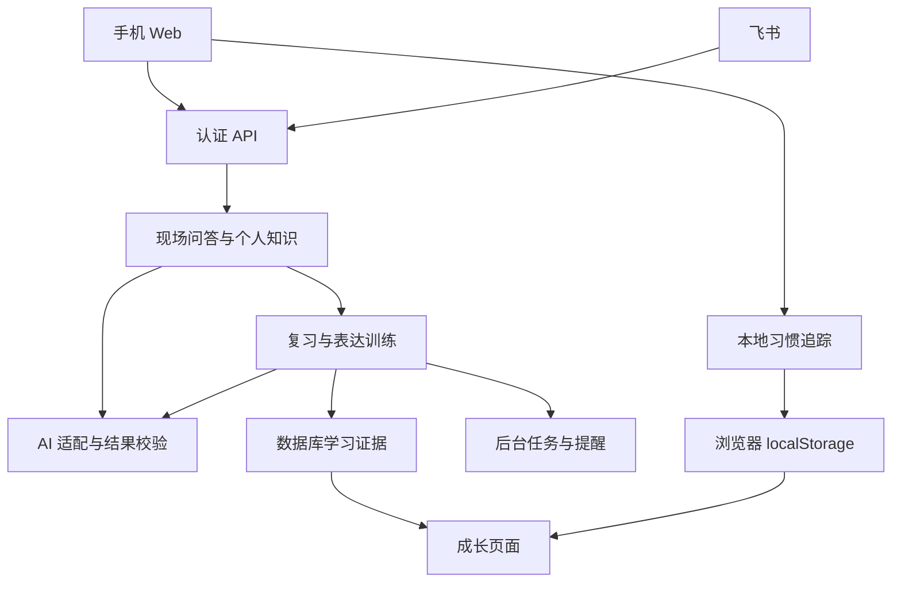

# Edward 个人概念理解与表达成长系统 V3.1 架构评审稿

版本：V3.1  
日期：2026年10月14日  
状态：核心方案和V3架构已获确认；按新增要求整合本地习惯追踪器，供实施与验收使用。  
基础材料：Edward 个人成长成功系统产品架构文档 v2.0。

第一阶段服务 Edward 或使用者本人：在真实交流中，用手机输入陌生术语，获得简短、准确、便于表达的解释；每天投入10—15分钟，把精选知识练成自己的表达，并留下可回看、可比较的成长证据。

V3.1新增本地习惯追踪：每日打卡、连续完成日历、周／月视图、每项习惯统计、添加／编辑／删除和颜色标记。它与练习入口共用导航，记录保存在当前浏览器的localStorage中。学习能力仍由表达、回忆和应用证据说明。

本次交付是产品与技术设计。原文列出的已完成功能、路由、数据表和安全问题尚未经过源码及运行验收，实施前必须在实际项目中核对。以下首版参数为设计默认值，试用指标为候选验收目标。

## 1 已确认的产品决策

| 决策 | 已确认内容 | 对设计的约束 |
|---|---|---|
| 首要成果 | 更快理解陌生概念，在会议或交流中准确表达 | 解释准确性、现场可用性优先 |
| 第一场景 | 交流正在进行，听到陌生概念后继续参与讨论 | 手机输入短、结果易扫读、等待可控 |
| 首版输入 | 手机打字输入术语或关键词 | 文字输入是完整主路径 |
| 第一阶段用户 | Edward或使用者本人 | 先验证个人效用，采用私用账号 |
| 每日时间 | 10—15分钟系统复习、表达练习与简短复盘 | 练习队列受时间预算约束 |
| 主要动力 | 看见能力进步，留下表达作品与成长记录 | 作品与表现成为成长页主内容 |
| 核心方案 | 现场问答＋每日表达训练＋作品与成长证据驱动 | 四个入口：问答、今天、知识、成长 |
| 新增习惯功能 | 每日打卡、连续日历、单项统计、增改删、颜色、本地存储、周／月视图 | 接入今天与成长；本地行为记录单独统计 |

产品定位：个人概念理解与表达成长助手。首版承诺围绕理解、表达与复用展开；国学、英语、领导力等作为内容领域逐步接入，体能与其他成长方向保留长期扩展空间。

首轮比较过快速问答、问答加表达训练、多领域成长平台三种范围。当前采用中间范围：保留即时价值，建立可观察的练习与反馈闭环，控制首版负担。

## 2 对 v2.0 的专业评估

### 2.1 已具备的产品基础

原方案有一个具体入口：交流中遇到陌生概念。知识捕获、复习、应用记录与演讲素材也已经形成可串联的功能基础。FastAPI、Vue、PostgreSQL及飞书集成能够继续承载首版，优先修复和整合现有流程。

核心潜力在于同一份知识可以进入后续练习和真实交流。若只保留生成解释，其价值容易停留在单次帮助；若能持续保存用户自己的表达、纠错与应用反馈，就能减少重复学习与重新整理的成本。这是待个人试用检验的设计判断。

### 2.2 六领域评审结论

| 评审方向 | 原文依据 | 主要问题 | V3处理 |
|---|---|---|---|
| 产品架构 | 1.2、1.3及八大模块 | 人群与任务覆盖广，第一成果不突出 | 先围绕现场概念理解和表达 |
| 游戏系统 | 2.1模块2、4.2 | 签到和次数奖励不能代表能力，等级缺少时间预算 | 主展示作品与里程碑，参与记录单列 |
| 学习设计 | 2.1模块3、5、7 | 翻面熟悉感、AI讲解与独立掌握混在一起 | 先自主作答，再揭示答案与反馈 |
| 技术可靠性 | 6.3、8.2、8.3 | 固定身份、失败字符串入库、重复事件与迁移风险 | 列为新流程上线前的阻断项 |
| 用户体验 | 5.2、8.2及推送表 | 手机场景与移动端P2冲突，入口与提醒负担较高 | 移动主路径优先，导航收敛至四项 |
| 商业验证 | 1.3、9.E | 高净值画像和付费意愿缺少行为证据 | 先证明本人持续使用的价值 |

### 2.3 需要纠正的两项具体规则

原等级表按“当前L级升至L＋1级所需XP”解释，达到20级需累加第1至第19段：

`累计XP = 100 × (1.5^19 − 1) ÷ 0.5 ≈ 443,168`

假设每天有效获得100 XP，需约4,432天，即12.1年。日收益是计算假设，原文尚未定义全部奖励值；该算例说明等级曲线必须与预期成长周期一起校准，不能仅用指数倍率说明成就感。

原文复习规则为1→2天、失败固定降低EF 0.2；原SM-2的早期成功间隔是1→6天，评分3要求费力但正确回忆，失败后的EF仍按评分公式更新。[1][2] V3选择明确版本的SM-2核心调度，并在第6节固定更新次序和重学规则。

## 3 首版范围与原模块处理

### 3.1 四个用户入口

| 入口 | 主要任务 | 首屏内容 |
|---|---|---|
| 问答 | 在交流现场理解陌生概念 | 输入框、近期问题、简短结果 |
| 今天 | 完成练习并记录每日习惯 | 预计时长、到期回忆、一个表达任务、今日习惯与周／月日历 |
| 知识 | 管理精选概念与参考资料 | 收藏、概念含义、练习状态、来源 |
| 成长 | 查看可追溯的进步与坚持记录 | 表达作品、前后对比、延迟回忆、应用记录；本机习惯统计单列 |

默认打开问答。个人设置通过头像进入，后台独立于普通导航。四个入口是一套流程的不同视图，记录共用同一个概念、知识版本和用户身份。

习惯管理作为“今天”的二级入口，复用实际项目中等价的旧习惯路由，不新增第五项主导航。习惯列表与记录按认证主体在本机分区，和服务端学习数据具有不同的存储边界。

### 3.2 八个原模块的演进

| 原模块 | 首版处理 | 资产处理 |
|---|---|---|
| 即时专家 | 升级为简短、有依据状态的现场问答 | 历史查询保留 |
| 游戏化成长中心 | 主展示作品、证据和少量里程碑 | 已获XP、等级、徽章及连续记录保留 |
| 间隔复习 | 接入主动回忆与时间预算 | 旧卡和旧复习事件保留并标记算法版本 |
| 学习内容 | 与个人知识库共用检索及详情入口 | 原内容与标签保留 |
| 知识管理全链路 | 收藏、确认卡片、练习、应用成为主线 | 图谱及原始资料保留 |
| 目标习惯 | 保留当前练习目标；新增本地习惯管理、打卡、日历与统计 | 服务端旧目标和习惯日志只读保留；明确导入后才进入本地追踪 |
| 国学经典 | 作为可选内容来源接入知识和练习 | 原文、解读与学习记录保留 |
| 智能推送 | 用户主动启用一个时间窗口 | 原配置留作兼容，旧Cron按迁移规则停用 |

首版不增加角色剧情、社交排行榜、分享增长、微信小程序、全量爬虫和复杂推荐。既有图谱、MASK、马斯洛及七习惯数据进入扩展或反思视图；这些分数不参与推算本轮的概念掌握程度。

### 3.3 首版完成边界

用户能够在手机上完成查询、查看完整结果、收藏、确认知识卡、复习、提交自己的短表达、收到具体反馈、记录一次应用，并在成长页找到全部对应证据。手机宽度下这条链路不能依赖桌面后台。

用户同时能够在“今天”管理本地习惯、完成或撤销每日打卡，查看清楚的周／月日历，在“成长”查看对应统计。刷新后本机记录保留；本地存储失败时如实提示，并可导出、校验导入当前账号的习惯文件。

主端采用响应式Web；飞书承接已有的文字入口、可选提醒和深链。首版不增加语音识别或OCR依赖。飞书可以保留“专家＋关键词”等旧命令，同时支持经明确入口触发的短文字查询；任意聊天文本不自动进入知识库或公开群。

## 4 现场问答的产品契约

### 4.1 输入与消歧

输入一个术语或几个关键词；场景描述可选。空输入在客户端拦截，过长输入提示缩短。只有不同含义会明显改变答案时，展示最多三个含义选项；否则注明本次采用的含义并继续，用户可切换。

查询不要求先设置目标、完成多维测评或填写个人画像。失败与取消保留输入。网络重放关联同一逻辑查询，返回已有状态；用户主动选择再次尝试时，可产生受预算限制的新执行尝试。供应商结果未知时仍可能再次计费，记录每次尝试及结果状态。

### 4.2 结果卡

| 层级 | 内容与默认长度 | 完成条件 |
|---|---|---|
| 核心解释 | 一至两句，约30—60字 | 解释核心含义，必要时说明本次词义 |
| 现场表达 | 一段，约50—100字 | 自然表达，保留重要前提与限制 |
| 按需展开 | 一个例子、易混点、边界、来源 | 与前两段含义一致，数字可追溯 |

长度是软约束，事实和必要条件优先。结果不得强迫加入数字、未经支持的案例或“权威专家”口吻。

依据状态采用“有资料依据”“已有知识生成”“需要核实”三类。第一类要求获取到资料，并能将关键主张对应到证据；网页存在本身不等于主张得到支持。来源包含标题、链接、获取时间和支持的要点。AI核对属于机器反馈，仍允许用户指出错误。

### 4.3 快速与完整的状态

流式显示只包含正式回答。生成中的文本标明未完成；完成内容检查后开放收藏和复制。若先有一段完整短解释，它必须拥有自己的完成状态；未完成的长文不以“完整回答”保存。

缓存或已确认个人知识优先，涉及变化中的信息、具体数字和时效性结论时核对资料及时间。检索失败仍可给一般概念解释，但必须如实显示依据状态，时效问题不借助陈旧缓存伪装最新结果。

以下是候选性能目标，必须按实际手机网络、供应商、模型配置和额度测量：

| 指标 | 初始目标 | 统计口径 |
|---|---:|---|
| 缓存命中后的完整短答 | p95不超过2秒 | 提交至完整可用短答 |
| 非缓存首段可读内容 | p95不超过5秒 | 提交至首段正式文本，仅反映等待体验 |
| 非缓存完整可用短答 | p95不超过10秒 | 内容检查完成、可收藏的短答 |
| 现场请求总超时 | 20秒 | 到期返回明确状态，允许选择继续查证 |

查证任务可继续后台执行，用户可取消对应任务。逻辑查询、执行尝试与结果版本分别标识；后台查证生成新结果版本，并提示有更新。已收藏知识保持当时版本，用户选择更新后再创建新知识版本。首段时间不能代替完整可用时间；未达到完整短答目标时，先调整快速模型、输出长度、缓存和检索范围，再评估现场承诺。

### 4.4 示范内容

输入：幂等性。

核心解释：同一个操作重复执行，对目标产生的预期效果与执行一次相同。

现场表达：我们需要让系统能够安全重试。同一个业务请求重复提交时，只产生一次预期的业务结果，避免重复办理。

展开边界：幂等关注预期效果，响应内容可以不同；HTTP中的POST不天然具备幂等语义，业务接口可以通过约定实现去重。[7]

这一例子用于说明结果结构。用户点击收藏不代表已经掌握；后续自己的解释与应用记录分别形成成长证据。

## 5 每日练习与成长证据

### 5.1 一次约12分钟的练习

| 环节 | 默认预算 | 操作 | 产物 |
|---|---:|---|---|
| 主动回忆 | 4分钟 | 先不看答案，回答到期卡片，再核对 | 回答、评分、卡片版本及时间 |
| 独立表达 | 5分钟 | 用自己的话讲清一个概念，写下短表达 | 原始文字作品和反馈 |
| 应用复盘 | 3分钟 | 有真实应用时复盘；否则完成一个不同于原例的新场景判断 | 真实应用记录或单独标记的模拟练习 |

到10分钟可提前结束，最长预算默认15分钟。每天默认新增不超过2张卡，到期队列超出预算时停止自动推荐新增。剩余到期卡保留真实日期，次日优先呈现；结束界面显示“本次已完成，仍有待复习内容”，不假称全部到期任务已清空。

首版每次练习至少生成一个有意义的产物，不要求每次都完成全部环节。较忙时可只完成一张卡或一段表达，累计成果持续保留。

### 5.2 精选卡片

收藏后的内容先成为候选卡片，用户确认才加入到期队列。卡片包含一个明确问题、二至四个必要要点、一个例子、一条边界以及来源引用。确认界面允许改写问题、删除无价值内容和暂存。

卡片的提问应能主动作答，例如“请用自己的话解释这个概念，并说明什么情况下适用”。任务快照固定本次要求的答案要点及是否考查边界、例子或场景。到期任务保存首次回答：首次作答提交前选择不会、请求提示或揭示答案时，该调度周期记q=0；先提交独立回答，再揭示答案核对的，按首次回答质量评分。提示后的即时重述记为补练，不再次推进调度成功计数，不计延迟回忆成功。

原研究支持主动提取对延迟保持的价值；本产品的时间分配、量表和交互组合仍需个人试用验证。[3]

### 5.3 表达反馈量表

每次保存原表达后再请求反馈。首版采用三项0—2级量表，展示每项的文字理由，保持相同任务之间可比较。

| 维度 | 0 | 1 | 2 |
|---|---|---|---|
| 概念准确性 | 存在核心错误或未答出 | 部分正确，有必要要点遗漏 | 必要要点正确，适用边界合理 |
| 独立清楚表达 | 无法独立说清 | 依赖提示或结构零散 | 不借助答案，结构清楚 |
| 场景应用 | 用法不成立或无法说明 | 用法合理，依据或限制不完整 | 能解释用法及限制 |

准确性只对当次任务要求的要点评分；没有场景任务时，“场景应用”记为不适用，不能记0。原例复述不当作新场景迁移，模拟练习不计真实应用。系统已记录使用提示的作品标为辅助表达，独立表达最高1，用户改评分也不能覆盖提示事实。模型无法确认事实依据时，准确性记为需人工核对；用户确认评分不将机器反馈或未知依据改为已验证事实。

模型返回候选评分、遗漏点、原文对应位置和一个改进建议。用户可确认或修正；保存AI候选结果与用户确认结果，显示评估者及量表版本。三项不合成精确的“综合能力百分比”，不同概念和不同难度不直接横向排名。

### 5.4 三种独立证据

| 证据 | 必须保存 | 能说明的范围 |
|---|---|---|
| 独立表达 | 原始作品、任务、提示使用情况、时间、反馈及修订版 | 当次表达表现 |
| 延迟回忆 | 间隔后的首次作答、评分、知识版本、最近答案暴露时间和日期 | 该知识在明确间隔后的回忆表现 |
| 实际应用 | 场合、实际说法、反馈及信息来源 | 一次自述或有外部反馈的应用 |

三者分别展示，实际应用可以先于复习测试发生。记录“用户自述”与“附有作品或外部反馈”之间的区别。独立表达依据用户声明及系统记录的交互，不声称能识别所有外部AI帮助。

成长页显示证据时间、最近表现和同概念前后作品。每周总结由这些记录生成；证据不足时展示待练习项。一次成功或一枚徽章不意味着永久掌握。

## 6 复习调度的明确规则

### 6.1 算法版本与评分

版本名：`sm2-core-budget-v1`。采用SM-2的核心EF和成功间隔规则；同日补练受每日时间预算控制，作为单独练习事件记录，不无限重复，也不再次推进调度成功计数。[1][2]

| 用户按钮 | 评分q | 判定要求 |
|---|---:|---|
| 没答出来 | 0 | 看答案前无法给出必要要点 |
| 费力答对 | 3 | 独立回忆，费力但必要要点正确 |
| 答对了 | 4 | 必要要点正确，有少量犹豫 |
| 轻松完整 | 5 | 无提示，完整且轻松 |

首次作答提交前选择不会、请求提示或揭示答案，该周期记q=0；先提交独立回答，再揭示答案核对的，按首次回答质量评分。提示后的即时重述记补练。以后一次满足间隔要求的首次无提示作答才可计入无提示回忆证据。历史q为1或2的事件保留原值，不重新解释。

### 6.2 调度状态

状态包含EF、当前间隔、连续成功序列次数、到期日期、算法版本与上次有效调度事件。总复习次数与连续成功序列次数分别保存；失败重置成功序列，保留总次数。

以下是本版本的规范性伪代码，取整固定为向上取整，间隔使用更新前EF：

```text
仅对新的、已到期的有效调度事件：
  old_EF = current_EF
  若 q < 3：
    successful_repetitions = 0
    interval_days = 1
  否则：
    若 successful_repetitions == 0：interval_days = 1
    若 successful_repetitions == 1：interval_days = 6
    若 successful_repetitions >= 2：
      interval_days = ceil(previous_interval_days × old_EF)
    successful_repetitions += 1
  current_EF = max(1.3, old_EF + 0.1 − (5−q) × (0.08 + (5−q) × 0.02))
  next_review_date = 本次复习的用户本地日期 + interval_days
  在一个事务内保存事件、状态和下一次调度周期
```

自定义的同日补练限制由版本名表达；不将本版本宣称为原SM-2所有机制的完整复制。后续FSRS可通过同一调度边界接入，升级前保留足够的完整复习事件并比较实际负担和延迟表现。

### 6.3 并发、日期与知识变化

同一调度周期只能提交一次有效评分。客户端生成幂等键，后端以用户、卡片、调度周期约束重复；跨端重试返回原结果。提前练习记录为补练，不改变已经安排的间隔。

事件时间使用带时区时间戳，到期日使用DATE。默认用户时区为Asia/Shanghai，可在设置中修改；历史事件保存当时的时区与本地日期，不随新设置重写。跨午夜重试仍关联原调度周期。

卡片确认后形成知识版本，编辑关键答案时创建新版本并开始新学习周期；历史表达继续引用当时版本，不被覆盖。轻微排版修改不重启周期，由编辑操作明确标记变更类型。

### 6.4 旧卡迁移

保留V2到期日期、EF、间隔、原次数及旧状态快照。仅有历史q值不足以恢复V3成功序列：V2的“有点印象”与V3的独立答对语义不同。只有原始作答、提示情况和评分语义均可核对的旧事件，才允许恢复。

其他旧卡保留原到期日；首次到期进入V3时，先初始化EF=2.5、成功序列=0，再应用本次首次回答的评分。原到期日前不批量重排全部旧卡，界面说明新学习周期与旧记录之间的区别。

## 7 以可见进步为核心的轻游戏机制

### 7.1 主反馈

每次练习结束展示“今天留下了什么”：一个原始表达、一处已纠正的问题、一次延迟回忆或一条应用记录。每周展示同概念作品对比、最近仍讲不清的要点，以及下周一个重点。

成长页主画面使用具体证据和作品。原XP、20级称号、23种徽章、连续记录与冻结令牌作为历史参与信息保留，不换算成专业水平或MASK能力分。

### 7.2 首版四个里程碑

| 里程碑 | 条件 | 追溯记录 |
|---|---|---|
| 首份原始表达 | 第一份非空的用户原始作答，系统已知AI稿不参与 | 作品ID、作答模式、时间 |
| 完成一次纠错 | 同一问题原稿与内容确有变化的修订稿，用户确认具体修正点 | 两个作品版本及反馈 |
| 一天后再次讲清 | 同一概念含义、关键答案版本、量表及可比任务的两次独立原始作答；两次准确性与独立表达均经用户确认达到2 | 两次作品、评分、作答时间与知识版本 |
| 首条应用记录 | 非空真实场景和实际说法，反馈可明确为暂无 | 场景、实际表达、反馈及记录类别 |

“一天后再次讲清”还要求两次实际作答至少相隔24小时、发生于不同本地日期。第二次任务开始前保存同知识版本最近学习、答案揭示或提示的时间快照，任务开始时间与该快照至少相隔24小时。作答时间使用服务端事件时间，后续核对答案或迟到点评不改变快照与时间判定。24小时是产品试用规则，不是认知科学的统一掌握阈值。

四项里程碑均为每用户、每里程碑代码、每规则版本首次授予，保存作品、评估确认版本与授予时间。评分或知识被纠正后，保留历史授予事实，标注证据已修正或不再满足当前条件，移出当前有效展示及周总结。实际应用里程碑表示记录行为，外部效果是否得到验证单独标明。

### 7.3 参与反馈与历史XP

V3首版记录练习次数、参与日期和作品数量。既有已启用的XP累计与分值规则保持兼容，历史余额、等级和徽章保留；所有旧新入口的授奖统一经过事件去重和奖励流水，避免重复复习或回调多次授奖。原XP尚未启用的环境不主动启用。

新增表达、点评和应用记录默认不增加新的XP奖励规则。新增里程碑由明确条件授予，不以总XP推断能力。XP展示退居辅助，停止或重算既有XP不包含在本次默认改造内。

后续增加新奖励或调整升级曲线前，先盘点实际奖励量、日收益和目标升级周期，再选择版本化规则。历史余额只登记可核对的期初余额，不补造奖励事件。查词次数、反复打开答案、复制AI稿和分享点击不作为能力晋级依据。

### 7.4 恢复与防刷

中断后保留全部作品、参与记录和知识，首页推荐一个小任务。每周参与日历默认替代多条连续记录的主展示；历史最长连续天数仍可查看。冻结日标记为保护日，不记为实际学习日。

同一业务事件重放只生成一份事实及一次里程碑。用户可以多次改作品或练同一概念，真实修改都保存；首份作品、首条应用等一次性里程碑按稳定条件键去重。同日快速重复点击不能形成延迟回忆证据。

本地习惯连续天数与学习参与连续记录使用各自的数据源和名称。手动勾选“表达练习”只形成一条习惯自述记录，不自动创建作品、复习事件、XP或学习里程碑。习惯漏一天后，累计完成和最长连续仍保留。

## 8 本地习惯追踪器

### 8.1 角色与首版范围

习惯追踪器帮助用户看见每日行动的积累，并降低记录负担。首版支持每天一次的习惯；名称和颜色可编辑，创建日期固定，习惯使用稳定UUID。名称去除首尾空白后为1—40个Unicode码点；同名习惯也拥有不同ID。颜色使用蓝、青、紫、琥珀、橙、玫红六个带名称的选项。

学习练习的10—15分钟预算继续成立。阅读、运动等习惯的实际执行时间另计；记录操作保持轻量。首版不增加复杂频率、冻结连续天数、社交排行榜、习惯能力分或云同步。日历显示的是用户记录，不声称验证了现实中的执行。

| 位置 | 功能 | 反馈 |
|---|---|---|
| 今天／今日习惯 | 名称、颜色、完成或撤销、今日已完成n/m | 写入成功后才显示已记录 |
| 今天／周视图 | 每习惯一张卡，周一至周日七格 | 完成符号、今天边框、补记标识 |
| 今天／月视图 | 选择一项习惯，七列日期和选中日详情 | 完成、待完成、未开始、未来状态清楚 |
| 今天／习惯管理 | 添加、改名、改色、删除；导出和恢复 | 编辑保留历史；删除说明记录数量 |
| 成长／习惯统计 | 累计、当前连续、最长连续、本周／本月完成率 | 单列本机记录，不混入表达量表 |

新用户的空状态只推荐可自行添加的习惯，不默认替用户创建或打卡。可以建议“复习一个精选概念”或“留下短表达”，但实际作品保存不会自动勾选习惯；用户仍确认自己的行为。

### 8.2 打卡、补记与删除

每个习惯、每个本地日期最多一条完成记录。操作使用“设为完成／设为未完成”的目标状态，不把重复网络或界面事件当作多次toggle。按钮处理中阻止重复触发；成功后可撤销，撤销删除当天记录并重算统计。

默认目标日期为今天。允许通过日历补记创建日至今天之间的日期；保存实际记录时间、操作时区和补记类别。创建前与未来日期不能新增打卡。过去缺少记录显示“未记录”，不直接断言现实中没有执行。

改名、改色保留ID、创建日期和全部记录。删除前显示“删除此习惯及N条打卡记录”，确认后只清理该习惯和关联记录；其他习惯不受影响。重新创建同名习惯使用新ID，不继承旧记录。

当应用已经加载有效账号、模型或服务器暂时不可用时，本地习惯操作仍可执行；未识别本人账号的冷启动不从任意账号键读取资料，不承诺完整离线登录。

### 8.3 日期与统计契约

日期键为明确用户时区下的`YYYY-MM-DD`，默认Asia/Shanghai。创建日和历史记录的日期、时区保留原值；更改时区只影响今后生成的日期，不重写历史。统计以当前设置生成的今天截取区间。时区切换后暂时落在未来的已有历史记录只读保留，暂不计入截至今天的统计，不按非法新打卡删除。

使用日历日期运算处理跨周、跨月、闰年和夏令时；不能截断UTC的`toISOString()`生成本地日期，也不能用毫秒差除以24小时计算连续天数。周一作为一周开始。

设有效完成集合C为该习惯创建日起、截至今天的去重完成日期：

| 统计项 | 固定口径 |
|---|---|
| 累计完成 | C中不同日期数，与按钮点击次数无关 |
| 当前连续 | 今天在C中，从今天向前数；今天不在C但昨天在C，从昨天向前数并标今天待完成；两者均不在C则0 |
| 最长连续 | C中最长相邻日历日期序列；不采用冻结日 |
| 本周／本月完成率 | 所选期间内有效完成日期数÷所选期间与“创建日—今天”交集的日期数 |
| 零分母 | 显示暂无数据，不显示0%或100% |

例如2026年10月20日创建，22日查看，20日和22日完成：本月为2/3，累计2天，当前连续1天，最长连续1天。创建前及23日以后不进入分母。今天未记录、此前连续3天且昨天完成时，当前连续仍显示3天；今日完成后显示4天。

补记会修正历史连续天数和完成率，界面同时保留补记标识。所有统计实时从原始记录计算，不另存一份可能失效的累计值。周间比较只比较完整周，未结束周展示已记录天数和可用分母，避免把半周和整周直接作下降结论。

### 8.4 周／月视图与激励

周视图每张习惯卡将名称放在日期格上方，七格只显示日期与状态。月视图一次选择一项习惯，固定七列，允许上一／下一周或月；选中日期下方显示习惯名称、记录状态、记录时间及补记信息。月外日期弱化，创建前和未来日期不可新增操作。

在320、375、768像素宽度验证无页面横向溢出。今日完成按钮触控区域至少44×44 CSS像素；月历窄屏日期格允许小于此尺寸，选中后在详情区域提供至少44×44的确认按钮。键盘可以到达习惯选择、日期与操作按钮；焦点、选中日、今天及完成各有可辨识样式。状态有文字或勾选符号，颜色只帮助区分习惯，减少动画模式仍有完整反馈。

激励文案使用真实积累，例如“本周已记录4天”“累计完成12天”。中断后保留总成果并提示“今天可以继续”；不承诺固定天数即可养成习惯，不用负面提醒迫使补记。完成动画可选，保存失败时不播放成功反馈。

### 8.5 本地存储与身份边界

新习惯的唯一事实源是当前浏览器localStorage。键采用`edward:habits:v1:<authenticatedUserId>`；身份由有效会话解析，不能采用URL或任意表单中的user_id。账号切换或注销先清空内存，待执行写入必须再次核验捕获的账号上下文，不能写进新账号的键。

| 本地对象 | 字段与约束 |
|---|---|
| 快照 | schemaVersion=1、ownerId、revision、resetEpoch、updatedAt、habits、checkIns、legacyImports（来源ID映射，默认空） |
| 习惯 | id、name、color、frequency=daily、createdDate、createdAt、updatedAt |
| 完成记录 | habitId、localDate、timezone、recordedAt、entryKind=today或backfill |

快照包含有限结构与有效日历日期；habitId引用必须存在，习惯ID及(habitId,localDate)不得重复。legacyImports只保存旧来源标识、新habitId及导入时间，不保存旧未知正文或推测日期；来源标识唯一，删除习惯时清理对应映射。schemaVersion不兼容、ownerId不符或JSON损坏时保留原值，显示恢复入口或只读错误状态，不静默清空并回写。

读取与写入都捕获浏览器策略限制和容量异常。成功写入后才更新内存、统计和已保存状态。revision用于变化追踪，不能代表事务。支持Web Locks时，同一账号的独占锁包住完整“重新读取—校验—应用变更—写入”，并递增revision；其他标签通过storage事件重载，本标签自行更新。[11][12] 不支持锁的环境明确限定为单标签编辑，并提示关闭其他编辑页；revision检查只能发现部分冲突，不承诺并发安全。

localStorage按站点来源保存，通常跨浏览器会话保留；不同浏览器、设备和站点来源不自动共享，隐私模式或清理站点数据可能删除记录。[10] 本产品不把它作为加密保险库；账号命名空间避免应用串用，不能抵御同源脚本读取。此模块不存API密钥、登录令牌或表达作品正文。

### 8.6 导出、恢复与旧数据

提供JSON导出，包含当前账号的版本化习惯快照、导出时间和时区。导入先校验文件类型、最多1 MiB、版本、账号、日期、引用与重复记录，再预览习惯数、记录数及覆盖范围；用户确认后替换当前账号的本机快照，不进行不透明自动合并。非法文件或写入失败保留现有数据。导出中的旧revision不直接作为新revision，有效目标恢复使用当前revision＋1及resetEpoch＋1。不可读目标保留原始文本供导出；明确恢复时先停止本模块操作并关闭其他编辑页，在单页状态下建立新基线，不能猜测旧版本计数。

清空本机习惯只清理当前账号本模块键中的习惯与记录，不调用`localStorage.clear()`，不删除其他账号、登录数据或其他模块。可保留空快照的版本信息：清空或恢复时递增resetEpoch，先前等待中的操作不得把旧数据写回。删除一项习惯和清空全模块使用不同操作及说明。

旧PostgreSQL习惯和目标保持可查看，新的本地模块不与其静默双写。迁移通过用户选择旧习惯、预览日期与记录映射后明确导入；无法核对的日期或完成记录列为待处理，不猜测，不把旧总次数补造成具体日期。来源ID映射保留在导入报告中，避免重复导入；没有实际旧模型或可用读取端点时，先交付本地新建、JSON恢复与旧页面兼容，记录旧导入适配的真实阻碍。

飞书仅提供进入已认证Web页的链接，不能直接写浏览器习惯记录。云模型、服务端成长汇总和推送默认不接收此模块数据；习惯周反馈由前端确定性统计生成。服务器备份不包含本地习惯，完整个人导出可由前端将服务端导出与本机习惯文件打包，清楚标明来源。本机清除和服务端删除分别说明；不能承诺从当前设备清除其他设备中的副本。

## 9 AI与系统架构

### 9.1 保持现有技术栈

采用模块化单体：Vue与移动响应式界面、FastAPI业务服务、PostgreSQL事实存储、现有Redis作为可丢弃缓存。后台任务与调度由一个专用执行进程承担；API请求进程不在每次启动时自行注册一组Cron。

多Agent专家用于本次设计和评审。首版运行时，解释、制卡、点评、周总结由四种受控任务模板与普通服务函数完成。每个任务只有确定的输入、输出和允许的写入范围。



### 9.2 服务职责

| 服务边界 | 负责 | 允许写入 |
|---|---|---|
| 身份与授权 | 登录、本人绑定、对象归属、会话撤销 | 用户与会话数据 |
| 概念问答 | 消歧、个人检索、来源、简短解释 | 查询及经校验结果 |
| 卡片管理 | 收藏、候选卡、用户确认、版本 | 知识和卡片 |
| 练习与调度 | 任务队列、主动回忆、调度状态 | 学习事件、复习状态 |
| 表达反馈 | 保存作品、固定量表、候选点评 | 作品及评估 |
| 成长汇总 | 证据视图、里程碑、周总结 | 可重建汇总与里程碑事件 |
| 通知与任务 | 用户订阅、任务状态、有限重试 | 后台任务与发送记录 |
| 模型适配 | 提供商协议、参数、用量、错误归一 | 调用元数据，不直接改业务事实 |
| 本地习惯前端 | 习惯管理、每日记录、日期统计、周／月视图 | 当前账号localStorage；不写服务端学习证据 |

名称是逻辑边界，实际文件和类名优先复用现有项目约定，不强行重建目录。

“成长”在当前浏览器组合服务端学习证据与本机习惯统计两个区域。服务器响应不假装已经包含本机记录；更换设备时明确显示本机习惯为空或待导入。

### 9.3 快路径与慢路径

快路径优先查个人已确认知识及有效缓存；检索到的内容只作为资料，不作为执行指令。缓存键包括用户、概念含义、语言、场景类型和内容版本。私有解释与个人作品不使用跨用户共享缓存。

快路径生成短回答，完成内容与来源状态检查后保存结果。慢路径包括候选制卡、点评和周总结，进入持久任务队列；用户的现场查询优先于后台调用。第一阶段后台并发默认1，交互并发默认1，供应商账户的总额度由同一限制器控制。

提供商、模型ID、上下文限制、推理模式、参数支持与额度，以实际账户和真实请求核对。原文的模型名、免费RPM与“只改环境变量即可切换”不能直接作为上线依据。至少为文本和结构化任务分别做契约验证。

### 9.4 输出与失败边界

`AIService`返回明确的状态、经过验证的结果、错误码和调用元数据。只有正式回答进入结果校验；`reasoning_content`不代替答案，不展示为解释，不进入知识或复习卡。[4]

检查空回答、截断、超时、429、格式错误和来源不足。失败记录留在请求或任务历史，失败提示不保存成知识正文。成功文本也不能自动形成掌握评分、习惯完成或目标完成。

如果供应商返回只含推理的响应，状态为失败，错误码为EMPTY_ANSWER；内容截断用TRUNCATED；超时、限流、结构错误分别归一。模型返回无可核对依据时保留“需要核实”状态，制卡需用户补充依据或明确确认一般解释后进行。

正文与JSON按各自任务契约检查，不以统一字符串fallback替代结构化失败。日志记录错误类别、用量、耗时和追踪ID，默认不记录密钥、完整个人反思与作品正文。

### 9.5 首次私用的P0要求

固定返回某个用户的`/auth/me`必须改为真实认证主体；所有知识、作品、事件、任务和缓存均检查归属。关闭开放注册，个人账号以部署时创建的有效账户进入。默认签名密钥使服务拒绝启动，允许来源明确配置；CORS不能代替鉴权。[6]

默认访问拓扑为需要登录的HTTPS入口：同源反向代理提供前端与API并终止TLS，FastAPI只允许代理所在受控网络访问，数据库与Redis不开放公网直连。手机离开本地网络也使用同一认证入口。服务端API密钥不进入浏览器；沿用JWT，建议访问令牌仅放浏览器内存，刷新令牌使用Secure、HttpOnly Cookie，刷新及注销操作校验Origin和CSRF。

本人账号与飞书身份明确绑定；未绑定或来源验证失败的事件拒绝处理。按实际使用的飞书协议及官方SDK核验事件来源，事件ID持久化去重。后台执行者同样检查输入对象归属。该拓扑是部署设计，本轮不创建域名、部署服务或调整实际网络。

个人反思和表达作品默认只在私有页面及本人会话中呈现。群推送须单独开启并选择内容范围，默认关闭。提醒默认关闭，用户可选一个时间窗口和频率，默认静默时段22:00—08:00，完成当天计划后抑制重复催促。

## 10 数据与接口设计

### 10.1 数据事实与最小增量

先盘点实际模型。原文的28张表及路由数量是描述口径，真实结构以源码、迁移记录与数据库为准。原表能承载下面的职责时优先扩字段；新增逻辑对象不要求机械地各建一张新表。

| 逻辑对象 | 主要字段 | 约束或索引 |
|---|---|---|
| 查询与知识 | user_id、sense、status、answer、source_refs、content_version、created_at | 按用户与时间检索；成功正文与失败状态分开 |
| 学习事件 | user_id、event_type、object_id、idempotency_key、payload、occurred_at、local_date、timezone | 用户与幂等键唯一；对象与时间索引 |
| 表达作品 | user_id、concept_id、knowledge_version、root_artifact_id、revision_no、body、assistance_mode、task_snapshot | 同根作品版本号唯一；版本不可覆盖 |
| 作品评估 | artifact_id、artifact_revision、rubric_version、status、ai_feedback、user_confirmed_scores、evaluated_at | 绑定精确作品版本；唯一任务键 |
| 复习状态 | card_id、algorithm_version、EF、interval_days、successful_repetitions、next_review_date、schedule_cycle_id | 卡片与版本唯一；用户、到期日及活动状态索引 |
| 后台任务 | user_id、task_type、input_ref、input_version、status、attempts、claim_epoch、lease_until、available_at、result_ref | 任务去重键唯一；状态与可执行时间索引 |
| 奖励流水 | user_id、learning_event_id、rule_version、delta、legacy_balance_marker | 学习事件与奖励规则唯一，保留真实期初余额 |
| 应用记录 | user_id、concept_id、scene、actual_expression、feedback、evidence_kind、occurred_at | 标明自述或附外部证据 |

时间使用TIMESTAMPTZ，业务到期日使用DATE；主键沿用项目UUID策略。固定关系使用外键，JSONB保存来源列表、任务快照及反馈内容。高频过滤和关联字段建立索引，是否增加更多索引以实际查询与执行计划决定。

幂等约束由数据库执行，不能只靠Redis存在判断。业务事实、事件与状态更新在同一个事务内提交。用户重复点击返回已提交结果；同一幂等键对应不同请求内容时返回冲突，不静默复用错误内容。

上表描述服务端事实。本地习惯使用第8.5节的版本化快照与日期唯一键，不新增服务端写接口或数据库习惯事实表；localStorage写入不受PostgreSQL事务保护。旧服务端习惯模型保持兼容读取。

### 10.2 首版接口契约

以下是逻辑契约；已有接口能兼容时优先扩展。字段变更采用兼容层和版本记录，不一次性推翻旧客户端。

| 接口 | 用途 | 关键要求 |
|---|---|---|
| POST /api/v1/expert/ | 关键词问答 | 身份校验、消歧状态、明确成功或失败 |
| POST /api/v1/expert/stream | 流式问答 | 只流正式内容；完成与失败事件明确 |
| POST /api/v1/knowledge/collect | 主动收藏 | 完整结果、内容版本、幂等键 |
| POST /api/v1/cards/confirm | 确认候选卡 | 保存答案要点与来源、创建学习周期 |
| GET /api/v1/practice/today | 今日练习队列 | 时间预算、到期优先、预计分钟数 |
| POST /api/v1/spaced-repetition/review | 复习评分 | 调度周期、版本、事务及重复检查 |
| POST /api/v1/expression-artifacts | 保存独立表达或修订 | 原稿先保存；修订新增版本 |
| POST /api/v1/expression-artifacts/evaluate | 请求候选点评 | 返回任务ID，不阻塞作品保存 |
| POST /api/v1/expression-evaluations/confirm | 确认或修正反馈 | 保存用户结论与候选反馈 |
| POST /api/v1/application-records | 记录现实应用 | 区分自述及外部反馈 |
| GET /api/v1/growth/evidence | 成长证据视图 | 可追溯，汇总可重建 |
| GET /api/v1/tasks/{id} | 后台任务状态 | 归属校验、重试状态、结果引用 |

流式协议提供status、answer_delta、completed、failed事件。completed表示完整结果已经进入对应校验边界；存在待核实的主张时，结果保留依据状态，不能将completed解释为绝对正确。

问答成功结果包括query_id、status、meaning、core_explanation、speaking_version、source_status、sources、content_version和metrics。source_status取source_backed、generated或needs_verification；status取needs_clarification、completed或failed，失败时返回error且answer为空。

后台点评状态取queued、running、succeeded、failed或cancelled；需要人工核对的反馈以结果内的evaluation_status表达。首版不自动接受候选评分。

### 10.3 操作与结果读取映射

| 操作 | 契约及参数 | 返回与归属 |
|---|---|---|
| 消歧续查 | POST /api/v1/expert/，携query_id、sense_id及新的操作幂等键 | 延续原逻辑查询，新结果保留版本 |
| 读取查询结果 | GET /api/v1/expert/{query_id}，可指定version | 返回指定结果版本及尝试状态 |
| 读取候选卡 | GET /api/v1/spaced-repetition/cards/{id} | 返回问题、要点、来源和确认状态 |
| 读取点评 | GET /api/v1/expression-evaluations/{id} | 返回精确作品版本的候选及确认反馈 |
| 取消任务 | POST /api/v1/tasks/{id}/cancel | 取消未完成任务；已完成返回明确状态 |
| 导出学习数据 | POST /api/v1/profile/export | 返回任务ID，完成后提供本人可读的导出结果 |
| 永久删除知识 | DELETE /api/v1/knowledge/{id}，明确permanent参数 | 清理对应正文、引用、缓存与未完成任务 |
| 清空个人学习数据 | DELETE /api/v1/profile/data | 清理本人学习资料，保留账户配置 |

表中是完整操作映射，实际路由优先复用已有等价端点。所有读取及后台输入解引用检查用户归属，客户端传入user_id不能替代认证主体。

result_ref采用类型、对象ID和版本，类型为expert_result、candidate_card、artifact_evaluation或export。小结果可随任务状态直接返回result，大结果经对应本人读取端点获取；导出下载同样要求登录。

成功读取返回200，排队任务返回202；消歧为200的needs_clarification状态。未登录返回401，跨用户对象统一视为不可访问；幂等键内容冲突返回409，输入错误返回422。网络重放获取正在执行的状态，不自动再调用供应商；用户明确重试会新增attempt，但仍关联原query_id。

### 10.4 生命周期与撤销

查询可以失败，收藏可以失败，点评可以失败；这些状态分别记录。保存失败显示未保存，不能只弹出成功动画。点评失败保留作品；删除或归档卡片停止其未来调度，并保留本人可查看的历史引用。

导出提供概念、卡片、作品、评估和应用记录的结构化文件。永久删除个人数据时，同时清理正文、关联证据、缓存和等待任务；删除后的后台任务不能重新写回内容。本系统备份默认保留7天，恢复时按第11.3节应用独立删除清单；日志保留匿名运行信息。

服务端“导出学习数据／清空个人学习数据”覆盖服务端资料；本机习惯通过独立JSON导出或前端组合导出覆盖。清空页面说明各范围；只有用户明确选择“同时清空本机习惯”时才调用当前账号本地清除。服务端恢复不会读取、覆盖或复活本机习惯。

## 11 运行与迁移边界

### 11.1 有限任务与通知

后台任务必须具备持久状态、稳定去重键和结果引用。领取时递增claim_epoch并设置租约。提交事务锁定任务与目标对象，只有当前claim_epoch匹配、任务仍为running、对象归属和版本匹配且未删除时才允许写入；结果按稳定任务键唯一。取消、删除与完成使用同一提交边界，旧尝试迟到不能提交。

结果保存与任务成功状态在一个事务提交，旧输入版本的结果不覆盖新作品。任务已完成时取消请求返回已完成状态，不假称已撤销外部调用；已取消任务不因租约过期重新启动。

普通后台任务默认最多3次尝试，间隔采用退避。外部模型调用超时可能处于结果未知状态，不能据此承诺供应商恰好只收费一次；记录attempt与用量状态，控制总预算。通知发送超时也记录未知状态，不无条件立即重发。

初期只启一个调度进程。APScheduler 3.x官方明确提示多个进程共享任务存储可能造成重复或漏执行；实际安装版本需在项目中核对。[5] 提醒的唯一键使用用户、通知类型及目标时段，旧Cron与新通知机制不同时运行。

关闭提醒后，未发送任务取消。已开始的外部发送可能无法撤回，发送记录保留实际结果。周总结在成长页按需生成或缓存，推送需单独启用。

### 11.2 模型数据与预算

只向配置的模型发送当前问题、必要参考要点或本次待点评的作品，不发送整个人知识库、全部历史会话和个人反思。来源资料中的指令作为内容处理，不能改变任务权限。界面说明AI处理范围；关闭云点评时，作品保存和本地练习仍可完成。

习惯追踪器不依赖模型调用；打卡、日历、统计和本地坚持反馈在前端完成，不因AI额度耗尽而失效，也不自动把习惯名称或记录附入云端周总结。

交互与后台共用供应商账户限额，按实际配置设置每分钟请求数、并发与日/月预算。预算到达上限时返回明确状态，仍可使用已保存资料；免费额度不作为持续运行的成本前提。

月模型成本按场景统计：

`Σ[场景调用次数 × (输入token × 输入单价 + 计费输出或推理token × 对应单价)] + 重试成本`

价格按实际账户当期计价单位录入，用量以供应商返回数据核对；缺失用量显示未知，不记0。存储、基础设施与人工支持分别记录。不给未经实测的单用户成本承诺。

### 11.3 备份与恢复

首版默认每天备份，保留7天，文件加密并限制访问。实施前先演练一次恢复，再安排结构变更。独立删除清单保存用户、对象ID、类型及删除时间，不含正文，默认保留14天；存放位置独立于被恢复的数据库快照，权限受限。

上述备份针对服务端数据。本机习惯由JSON导出保存，浏览器清理后的恢复依赖用户保留的文件，不能从服务端数据库备份找回。

永久删除先持久化清单，再清理主库、缓存和任务；中断时按清单继续清理，未完成显示处理中。备份在7天保留周期内轮换。恢复先隔离服务，恢复数据库后读取独立清单清理旧对象、取消关联任务并使缓存失效，再开放访问。重新创建的内容使用新对象ID，不被旧清单误删。

数据库迁移采用Alembic版本管理。[8] 建立基线前核对真实结构与已有迁移，禁止为跳过问题盲目标记版本。采用新增字段、清洗回填、对账、切换读写、最后收紧约束的顺序。

迁移期间保留旧读取所需字段。无效日期、重复卡片、未知奖励来源进入异常清单，不静默猜测修正。回滚能力由恢复演练、兼容旧字段和备份共同保证，不能仅凭存在降级脚本推断数据可完整恢复。

### 11.4 发布与撤回

新问答、训练、成长视图分别以配置开关启用；数据库更改先保持向后兼容。V3主流程发生阻断时可以回到既有可用入口，已产生的新作品和证据仍保留。旧认证或默认密钥问题不通过回退重新放开。

旧提醒先取消注册，再启用新用户订阅；保留发送记录和取消记录。所有新路由与模型改动须在实际源码中核对旧客户端调用，旧接口兼容失败会阻止切换。

## 12 改造顺序与首版里程碑

### 12.1 三个实施阶段

| 阶段 | 必须完成 | 进入下一阶段的门槛 |
|---|---|---|
| P0 可靠性基础 | 实际项目盘点、备份恢复、真实身份、归属检查、默认密钥治理、AI成功失败分离、回调去重、迁移基线 | 关键失败不会污染知识，身份与数据边界可验收 |
| P1 个人闭环 | 先验收手机问答的速度、来源与核心准确性，再接收藏、复习、表达反馈和成长证据；整合本地习惯追踪 | 本人能独立完成学习链路及习惯管理、打卡、日历与统计 |
| P2 试用调优 | 根据真实数据调节练习负担、缓存与资料覆盖、作品对比、内容接入、可选提醒 | 30天证据说明实际价值，运行成本可解释 |

阶段是依赖顺序，完成日期需结合源码盘点和实际团队产能估计。P0只完成安全可用与本次改动必需的基础，不要求一次重构全部旧模块。P1分三段交付：现场问答先实测成立，接收藏与复习，再接表达与成长；后台任务和新增模型按对应段落引入。第一阶段优先完成少量完整流程，不按原70个API或22条路由逐页扩充。

习惯子项目在真实账号与前端目录核对后可以独立开发，交付点依次为本地可靠存储、增改删与打卡、统计和周／月视图、今天／成长接入及恢复验收。它不等待AI点评上线，也不抢占现场问答的模型额度。主系统和习惯子项目分别提供开发计划，由共同启动说明协调。

### 12.2 现有模块的保护要求

修改导航不删除旧内容或表；历史路由可由兼容链接访问。目标、习惯、经典、演讲稿、已有卡片、旧XP与成就均先备份和对账。数据库调整通过迁移完成，真实环境不以重建数据库代替升级。

每个阶段分别保存可复核的结果：结构盘点与风险列表、端到端录像或截图记录、迁移前后对账、真实调用耗时和用量、手机实际操作结果。文档中的完成勾选不代替这些证据。

## 13 30天个人验证

### 13.1 主问题

系统是否让本人在真实交流中更快获得可用解释，并在后续不依赖答案时表达得更准确？查询数量、打卡和XP只能说明参与，主结果来自现场应用与前后作品。

### 13.2 试用安排

| 时段 | 动作 | 记录 |
|---|---|---|
| 第1—3天 | 建立原有查词方式、耗时与短表达基线 | 一组代表性概念与原始表达 |
| 第4—10天 | 在真实交流中使用现场问答，精选卡片 | 等待、是否可用、来源状态、实际使用 |
| 第11—20天 | 按每日预算复习、表达和复盘 | 原稿、反馈、修订、延迟回忆 |
| 第21—30天 | 减少额外催促，复测旧概念和相近难度新概念 | 自主使用、前后对比、继续使用意愿 |

基线任务与复测任务尽量匹配难度和场景，记录是否看到过答案、是否借助其他AI、练习时间与提示。比较记录可以帮助个人判断价值，不将单人前后变化解释为严格因果证明或市场验证。

### 13.3 指标定义

| 指标 | 定义 | 用途 |
|---|---|---|
| 完整可用短答时间 | 提交至完整解释通过内容检查 | 检验现场等待 |
| 现场可用比例 | 用户标记能用于当次交流的成功结果数÷有反馈结果数 | 检验相关性，报告样本量及无反馈数 |
| 核心错误率 | 经复核存在核心错误的结果数÷已复核结果数 | 防止准确表达被自信语气替代 |
| 无提示表达表现 | 同量表、相近任务的各项前后表现 | 检验表达改善 |
| 延迟回忆表现 | 首次无提示有效成功事件数÷有效延迟复习事件数 | 检验回忆；合格的首次失败计入分母 |
| 实际应用 | 有场景和说法的应用记录，区分自述及外部反馈 | 检验工作连接 |
| 主动负担 | 练习分钟数、积压、等待放弃及提醒关闭 | 检验日常可持续性 |
| 模型用量与失败 | 按任务统计调用、token、失败与重试 | 检验成本和可靠性 |
| 本机习惯完成 | 唯一完成日期、当前／最长连续、期间完成率及补记数量 | 检验记录和坚持体验，不推断理解或表达能力 |

初轮候选观察目标：至少15次真实场景查询、5条具体应用记录、10份原始表达作品、3组同概念前后对比、10次有效延迟回忆。自然场景不足时保留真实数量，不用模拟查询冒充实际应用。

统计按稳定对象计数：同调度周期只计一次；原始作品按root_artifact_id计数，修订不增加原始作品数；提示补练与同日补练单列。有效延迟事件要求任务开始前距同知识版本最近学习、答案揭示或提示至少24小时，并保存该时刻的暴露时间快照。任务中不会或请求提示导致的首次q=0是有效失败，计入合格分母；随后的提示重述不进入分子或再次进入分母。分母为0显示暂无数据。

作品比较区分同题改稿对比与跨日独立作答对比；独立表现比较使用同知识版本、同量表、可比任务及可比辅助模式。未知评分不当0，周反馈附样本量与证据链接。24小时为本产品统计规则，按日到期复习事件不一定都满足它。

这些数量是覆盖观察场景的设计目标，不是行业基准。初轮继续使用判定采用以下预设条件：

- 使用至少5组相近难度的代表任务比较原方法与新系统，中位完整可用时间下降至少20%，并单列现场10秒目标的达成情况。
- 本人按原资料核对定义、必要条件及具体数字；不能核对的标为未决。首轮至少复核30条结果，核心错误率不高于匹配的基线，发现的核心错误有修正和停止错误卡片继续训练的记录。
- 至少3组跨日独立表达对比中，2组准确性或独立表达有所改善，另一项不下降；基线已经满级则检验相近难度新场景表现，不假称提升。
- 第3和第4周均有不依赖额外人工催促的主动使用，至少3次真实交流记录说明具体帮助，本人愿意继续使用。

20%、30条及2组改善是首轮设计阈值，不是普遍有效性标准。自然场景或可核对样本不足时结论为证据不足；速度、正确性或表达未改善时，先修相应流程，再扩展模块。模拟任务不冒充真实应用。

## 14 首版验收矩阵

下列为实际项目需执行的验收要求。本次架构稿未运行这些产品验收。

| 编号 | 场景 | 通过条件 |
|---|---|---|
| A01 | 手机短文字查询 | 无需填写画像，完成输入、读答、收藏主路径 |
| A02 | 概念有多个含义 | 必要消歧后解释一致，切换词义不混用旧缓存 |
| A03 | 实时信息或数字 | 来源及获取时间可查看，过期资料不标为最新 |
| A04 | 只有推理或空正文 | 明确失败，不生成知识或复习卡 |
| A05 | 输出截断、超时、429、格式错 | 保留输入、显示对应状态，失败不作成功统计 |
| A06 | 连点提交及并发重放 | 同一幂等请求只有一个业务结果；不同内容同键返回冲突 |
| A07 | 收藏和确认卡片 | 只有完整结果可收藏，确认前不进到期队列 |
| A08 | 首次作答前看答案或请求提示 | 原到期周期q=0，重述记补练；正常独立提交后核对答案不覆盖首次质量 |
| A09 | q为0、3、4、5及失败后重学 | 按第6节规则更新EF、成功序列和到期日 |
| A10 | 两端对同一调度周期提交 | 只提交一次有效调度，重复返回原状态 |
| A11 | 跨午夜、改时区、请求重试 | 旧周期和历史归日保持一致，事件不重复 |
| A12 | AI点评失败或超时 | 作品仍已保存，候选反馈可重试 |
| A13 | AI稿、独立原稿与修订稿 | 作答模式可查看，原稿不被生成稿覆盖 |
| A14 | 新作品版本与迟到点评 | 旧点评不覆盖新版本，作品和量表引用准确 |
| A15 | 时间预算及大量到期卡 | 默认不超过15分钟，保留剩余到期事实，停止新增推荐 |
| A16 | 中断几天后回来 | 历史成果保留，从一个小任务开始 |
| A17 | 离开本地网络、未登录、伪造身份及未绑定飞书 | 手机可经认证HTTPS使用，拒绝越权写入和后端直连，API密钥不出现在客户端 |
| A18 | 旧Cron与新提醒、重复回调 | 单调度入口，关闭提醒后不创建新的待发送任务 |
| A19 | 迁移与恢复 | 记录数、旧XP、旧到期日、作品引用对账，恢复演练成功 |
| A20 | 删除、取消、租约过期和旧尝试迟到 | 提交资格检查阻止迟到写入，已删内容不复活，缓存失效 |
| A21 | 成长里程碑 | 条件、证据和日期可追溯；重复点击不重复授予 |
| A22 | 手机与键盘可访问性 | 无横向溢出，焦点清楚，状态有文字，减少动画可用 |
| A23 | 导出个人资料 | 概念、卡片、作品、评估及应用引用完整 |
| A24 | 真实速度与用量 | 至少30个代表请求，分别报告缓存/非缓存耗时、错误、取消及未知用量 |
| A25 | 删除后恢复删除前备份 | 先隔离恢复，再按独立清单清理，正文不重新出现 |
| A26 | 用户修正评分或关键答案 | 历史里程碑保留但当前有效展示随证据更新 |
| A27 | 消歧、查证更新与结果读取 | 客户端可解引用精确结果版本，旧收藏不被覆盖 |

本地习惯增加以下验收，与学习链路分别判定：

| 编号 | 场景 | 通过条件 |
|---|---|---|
| H01 | 添加、编辑、颜色及删除 | 名称和颜色编辑保留ID及记录，删除只影响目标习惯，新建同名不继承历史 |
| H02 | 每日打卡、重复点击、撤销、补记 | 同习惯同日期最多一条记录；补记可辨识；撤销后统计一致重算 |
| H03 | 跨午夜、闰日、夏令时和改时区 | 按明确时区与日历日期计算，历史归日不重写，创建前和未来不能新增 |
| H04 | 今天尚未完成与连续中断 | 昨天结束的连续天数保留并提示今日待完成；昨天也漏记则当前为0，累计与最长保留 |
| H05 | 月中创建、未结束周及零分母 | 期间分母排除创建前和未来，2/3算例成立，完整周才直接比较，零分母显示暂无 |
| H06 | 周／月视图和可访问性 | 320／375／768px无页面横向溢出，月视图单项清楚，文字／符号状态、键盘和减少动画可用 |
| H07 | 刷新及AI不可用 | 已保存习惯在同源同浏览器刷新后保留，已加载账号可继续本地操作，无模型调用 |
| H08 | 切换账号、注销及等待写入 | 内存及时清空，写入重新核验捕获的账号上下文，不串用另一账号 |
| H09 | 存储拒绝、容量不足、损坏及未知版本 | 不假保存、不静默覆盖原值；错误与恢复入口明确，导出原始损坏值供处理 |
| H10 | JSON导出和校验恢复 | 同账号有效文件预览后恢复，非法日期、引用、重复、未知版本及超大文件拒绝且原数据保留 |
| H11 | 同源两标签与无锁环境 | 支持Web Locks时不同操作均保留并同步视图；无锁时明示单标签范围，不作原子性承诺 |
| H12 | 学习证据、XP及隐私隔离 | 手动或补记不创建学习事实或授奖，不上传服务器、AI或飞书，不把打卡当掌握 |
| H13 | 本机清除与完整导出 | 只清当前账号习惯键，服务器和其他账号完整；组合导出标明服务端／本机来源 |
| H14 | 旧习惯兼容与明确导入 | 旧数据可读，新记录无双写；导入有映射预览和报告，无法核对的完成日期不补造 |

性能样本较小时同时报告逐条记录和样本量，p95仅作为初步观察，持续试用后再判断稳定性。失败、取消和待核实均保留类别，不能从统计中静默删除。

## 15 后续扩展与商业边界

个人阶段重点证明长期效用。形成稳定闭环后，可接入商务英语、国学、领导力等内容，让不同领域复用同一套卡片、表达、反馈与应用机制。多领域内容不另外复制一套成长分数。

邀请试用前，必须完成真实多用户登录、对象隔离、每用户通知订阅、时区、配额、导出删除及管理权限验收。已有硬编码身份不能仅加一个注册按钮后作为多用户产品。

商业化阶段再验证他人能否独立获得相同成果、愿否持续使用及付费，并核算普通与重度用户成本。高净值标签、个人满意、XP增长或邀请人数都不足以证明付费需求。当前不据此设定市场规模、价格或收入预测。

## 16 确认记录与实施范围

需求澄清与重要方案确认已完成8次，未超过用户提出的10次上限。核心方案已明确确认，V3架构呈现后用户回复“请继续”；本轮又明确要求整合本地习惯追踪器。以下是据此采用的实施范围和设计默认值：

1. 响应式Web作为完整主端，飞书复用现有文字入口和可选提醒。
2. 文字作品优先，每日约12分钟、最长默认15分钟、每天默认新增最多2张卡。
3. 三项可解释量表、AI候选反馈经用户确认、作品版本与三种成长证据分别记录。
4. SM-2核心预算版本，明确评分、EF、1和6天间隔、失败重学、旧卡逐张切换。
5. 四个里程碑与每周作品反馈；既有XP规则与累计兼容，新训练流程不自动增加奖励规则。
6. 真实身份、归属校验、失败入库防护、幂等与迁移属于P0，后台执行进程默认1个。
7. 认证HTTPS主入口，提醒及群推送默认关闭；备份每天一次、保留7天，独立删除清单保留14天。
8. 性能数值及30天观察数量作为试用目标，实际数据决定是否达标。
9. 本地每日习惯支持增改删、六色标记、打卡／撤销／补记、清晰周／月视图和单项完成统计。
10. localStorage为新习惯唯一事实源；按账号分区、真实保存、JSON恢复、旧数据明确导入；不自动上传或参与能力／XP计算。

本次继续交付主系统开发计划、本地习惯子项目计划与Codex／Qoder启动说明。实际代码实施先在真实仓库中发现并核对现有实现，再按P0、P1、P2及依赖顺序推进。架构稿不把逻辑模块名或接口建议冒充已存在的源码路径，也不把文件生成视为软件已运行。

## 17 一手参考资料

下列资料支持算法、学习方式与特定技术边界；首版时间预算、量表、里程碑和性能目标属于本项目的设计选择。

| 编号 | 资料 | 支持范围 |
|---|---|---|
| [1] | [SuperMemo原SM-2说明](https://super-memory.com/english/ol/sm2.htm) | 早期间隔、评分语义、EF和重学原则 |
| [2] | [SuperMemo官方示例源码](https://super-memory.com/english/ol/sm2source.htm) | 以旧EF计算间隔、失败重置与EF公式 |
| [3] | [Roediger与Karpicke 2006原研究摘要](https://pubmed.ncbi.nlm.nih.gov/16507066/) | 提取练习及延迟保持；不直接验证本产品 |
| [4] | [Moonshot思考模型文档](https://platform.kimi.com/blog/posts/kimi-thinking) | content与reasoning_content的区别；该文档不证明原文模型名或额度 |
| [5] | [APScheduler 3.x官方FAQ](https://apscheduler.readthedocs.io/en/3.x/faq.html) | 多进程共享任务存储的重复或遗漏风险 |
| [6] | [FastAPI官方CORS文档](https://fastapi.tiangolo.com/tutorial/cors/) | 明确允许来源及浏览器跨域边界 |
| [7] | [RFC 9110第9.2.2节](https://www.rfc-editor.org/rfc/rfc9110.html#section-9.2.2) | HTTP幂等的预期效果语义 |
| [8] | [Alembic官方迁移教程](https://alembic.sqlalchemy.org/en/latest/tutorial.html) | 应用级迁移环境及版本化升级 |
| [9] | [Anki官方调度文档](https://docs.ankiweb.net/manual/deck-options) | 后续FSRS接入参考及复习负担控制 |
| [10] | [MDN localStorage](https://developer.mozilla.org/en-US/docs/Web/API/Window/localStorage) | 同源、会话持久性、隐私模式与存储策略限制 |
| [11] | [MDN storage事件](https://developer.mozilla.org/en-US/docs/Web/API/Window/storage_event) | 其他同源文档接收变化，发起写入的窗口不接收自己的事件 |
| [12] | [MDN Web Locks API](https://developer.mozilla.org/en-US/docs/Web/API/Web_Locks_API) | 支持环境中协调同源标签，锁覆盖完整读改写 |


